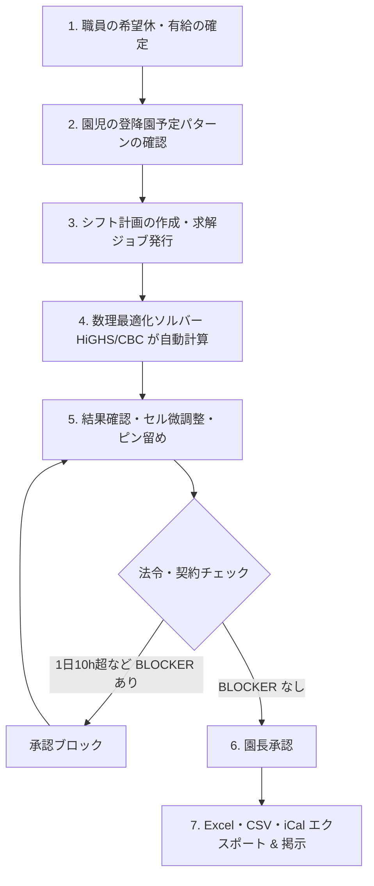

# 🧸 nusoft (NuShift) 総合操作・運用マニュアル (v0.4.1)

本書は、保育ICTプラットフォーム **nusoft (NuShift / shiftai v0.4.1)** の運用・操作マニュアルです。  
園長・施設長、主任保育士、一般保育士、事務職員、およびシステム管理者の皆様が、日々の業務で安全かつ円滑にシフト自動作成エンジンをご活用いただけるよう、実践的な手順を網羅しています。

> NuShift は **MIT License** (オープンソース) のもとで公開されています。商用利用・カスタマイズを含め自由にご活用いただけます。

---

## 目次

1. [はじめに & システム推奨環境](#1-はじめに--システム推奨環境)
   - 1.1 NuShift の思想
   - 1.2 推奨動作環境
2. [第1章: ログイン・セキュリティ・アカウント管理](#2-第1章-ログインセキュリティアカウント管理)
   - 2.1 ログイン手順と多要素認証 (MFA)
   - 2.2 パスワード変更とパスワード紛失時の復旧
   - 2.3 職員権限（ロール）の管理
3. [第2章: 初期設定と台帳管理](#3-第2章-初期設定と台帳管理)
   - 3.1 施設基本情報・開園時間・定員の設定
   - 3.2 クラス編成の登録
   - 3.3 園児・家庭台帳の登録（個別登録 & CSV一括取込）
   - 3.4 職員台帳・資格・有給休暇マスタ
4. [第3章: 職員配置基準連動 シフト自動作成 (NuShift)](#4-第3章-職員配置基準連動-シフト自動作成-nushift)
   - 4.1 シフト作成の全体フロー（月次・週次）
   - 4.2 職員契約・36協定・変形労働制・希望休の設定
   - 4.3 求解ジョブの実行（数理最適化ソルバー HiGHS / CBC）
   - 4.4 シフト結果の確認（「実行可能解」と必要配置数）
   - 4.5 セル編集と「ピン留め (Pinning)」機能による再計算
   - 4.6 労働基準法違反 (BLOCKER) と園長承認ゲート
   - 4.7 急なお迎え変更と「リアルタイム配置割れギャップ警告」
   - 4.8 掲示用 Excel 勤務割表、記号マトリクス、割増賃金 CSV のエクスポート
5. [第4章: システム管理・バックアップ・障害復旧](#5-第4章-システム管理バックアップ障害復旧)
   - 5.1 機微情報アクセス & シフト求解監査ログの確認
   - 5.2 自動バックアップの仕組みと手動バックアップ
   - 5.3 バックアップからの復元（リストア）手順
   - 5.4 トラブルシューティング（緊急連絡先・一次切り分け）
6. [管理者向け運用チェックリスト](#6-管理者向け運用チェックリスト)
   - 6.1 日次チェックリスト
   - 6.2 週次チェックリスト
   - 6.3 月次チェックリスト
7. [用語集](#7-用語集)
8. [トラブルシューティング詳細表](#8-トラブルシューティング詳細表)

---

## 1. はじめに & システム推奨環境

### 1.1 NuShift の思想

NuShift は、「園児と向き合うあたたかな保育の時間」を最大化するために設計されています。  
手書き書類や煩雑な勤務シフト作成、配置基準の複雑な確認作業を数理最適化技術で自動化し、保育士の負担を劇的に軽減します。

### 1.2 推奨動作環境

| 端末区分 | 推奨環境 | 主な用途 |
| :--- | :--- | :--- |
| **事務用 PC** | Windows 10/11, macOS, Chrome / Edge 最新版 | 園長・主任・事務の管理業務、シフト作成・承認 |
| **保育室 タブレット** | iPad (iPadOS 16+), Android タブレット (10インチ以上) | シフト表確認、セル編集・ピン留め |
| **保護者 スマートフォン** | iPhone (iOS 15+), Android (Android 10+) | 出勤シフト確認 (iCal連携) |

---

## 2. 第1章: ログイン・セキュリティ・アカウント管理

### 2.1 ログイン手順と多要素認証 (MFA)

NuShift では、園児の個人情報や職員の労務情報を保護するため、**多要素認証 (MFA - メールOTP)** を採用しています。

1. **ログイン画面へアクセス**: ブラウザで `http://localhost:8501` (ローカル) または `https://<自園のドメイン>/` を開きます。
2. **IDとパスワードの入力**: 登録済みのメールアドレスとパスワードを入力し、「ログイン」をクリックします。
3. **認証コードの受信**: 登録メールアドレス宛に「【NuShift】ログイン認証コードのお知らせ」というメールが届きます（6桁の数字）。
4. **コード入力**: 画面に表示された入力枠に6桁の数字を入力し、「認証」をクリックします（有効期限は10分間です）。

> [!NOTE]
> 専用のAuthenticatorアプリ（Google Authenticator等）のインストールは不要です。スマートフォンやPCのメールさえ受信できれば、どなたでも簡単に安全なログインが可能です。

**画面イメージ**: ログイン画面（メールアドレス・パスワード入力欄、6桁認証コード入力欄）

### 2.2 パスワード変更と復旧

- **パスワード変更**: 画面右上の職員名をクリック ＞「マイアカウント設定」＞「パスワード変更」から行います。
- **パスワードを忘れた場合**: ログイン画面の「パスワードをお忘れの方はこちら」をクリックし、登録メールアドレスを入力します。パスワード再設定用の一時URLがメールで届きます。

### 2.3 職員権限（ロール）の管理

職員ごとに適切な権限を設定することで、誤操作や情報の過剰閲覧を防止します。

| ロール | 主な権限 |
| :--- | :--- |
| **園長 (Admin)** | 全機能の利用、シフトの最終承認、施設設定、バックアップ、監査ログの閲覧。 |
| **主任 (Chief)** | シフト計画の作成・求解・編集、お知らせ配信、職員台帳管理。 |
| **一般保育士 (Staff)** | 自身のシフト確認・希望休申請、クラス園児の出欠確認。 |
| **事務・経理 (Accountant)** | 給与シミュレーションCSV確認、エクスポートファイル管理。 |

**画面イメージ**: 職員権限設定画面（ロール選択プルダウン、権限一覧テーブル）

---

## 3. 第2章: 初期設定と台帳管理

### 3.1 施設基本情報・開園時間・定員の設定

メニュー「施設設定」＞「基本情報」を開きます。

1. **基本情報**: 施設名、郵便番号、住所、電話番号、認可区分を設定します。
2. **開園時間**:
   - 開園時刻（例: 07:00）および 閉園時刻（例: 20:00）
   - 保育標準時間枠（例: 07:30 〜 18:30）
   - 保育短時間枠（例: 08:30 〜 16:30）
3. **休園日**: 日曜日、祝日、年末年始（12/29〜1/3）など定期休園日を指定します。

**画面イメージ**: 施設基本情報設定画面（入力フォーム、時間ピッカー）

### 3.2 クラス編成の登録

メニュー「クラス管理」から、年度ごとのクラスを登録します。

- **年齢区分**: 0歳児、1歳児、2歳児、3歳児、4歳児、5歳児
- **クラス名**: （例: ひよこ組、りす組、うさぎ組、きりん組、ぞう組）
- **定員および担当保育士**: 主担任・副担任を割り当てます。

### 3.3 園児・家庭台帳の登録

「園児台帳」メニューより、新規登録または一括CSV取込が可能です。

- **個別登録**: 氏名、生年月日、クラス、認定区分（1号・2号・3号）、標準/短時間の別、緊急連絡先、アレルギー情報を入力します。
- **一括CSVインポート**:
  1. 「CSVテンプレートをダウンロード」をクリックします。
  2. Excel 等で園児・保護者情報を入力し、CSV（UTF-8）形式で保存します。
  3. 「CSVファイルをアップロード」をクリックすると、プレビュー確認画面を経て一括登録されます。

### 3.4 職員台帳・資格・有給休暇マスタ

「職員管理」メニューより、職員の基本契約と資格情報を登録します。

- **保有資格**: 保育士、看護師、子育て支援員、幼稚園教諭などの資格をチェックします（※配置基準ソルバーの計算対象判定に使用されます）。
- **雇用形態**: 常勤（フルタイム）、非常勤（パート・固定時間、シフト枠指定）。
- **有給休暇台帳**: 年次有給休暇の付与日数、残日数を管理します。

---

## 4. 第3章: 職員配置基準連動 シフト自動作成 (NuShift)

NuShift の最大の特徴である、**法令配置基準連動 数理最適化シフト自動作成エンジン** の操作手順です。

### 4.1 シフト作成の全体フロー

**画面イメージ**: シフト作成ウィザード画面（ステップ進捗バー、入力フォーム）

### 4.2 職員契約・36協定・変形労働制・希望休の設定

1. メニュー「シフト管理」＞「職員条件設定」を開きます。
2. 職員ごとに以下の条件を確認・設定します：
   - 週間契約時間、1日最大労働時間（例: 8時間）
   - **36協定の有無**: 未締結の職員は法定労働時間（1日8時間）がハード上限となり、8時間を超えるシフト作成はブロックされます。
   - **1か月単位の変形労働時間制**: 変形労働制が適用される職員は、月間法定総枠（週40時間基準）の範囲内で日・週の柔軟なシフト配分が可能になります。
   - 月間希望休（「この日は休みたい」日程）
   - 承認済み有給休暇（有給管理モジュールから自動反映されます）
   - 連続勤務日数上限（通常5日または6日）

### 4.3 求解ジョブの実行（数理最適化ソルバー & ウォームスタート）

1. 「シフト計画作成」をクリックし、対象期間（7日間〜1か月）を選択します。
2. 配置基準を選択します（例: `全国基準（厚労省）`、`東京都基準`、`福岡市基準` 等）。
3. **ソルバー選択 & パターンモード**:
   - **ソルバー選択**: 標準の `CBC` に加え、高速オープンソースソルバー `HiGHS` を選択可能（大規模月間シフトで大幅な求解高速化）。
   - **ウォームスタート（初期解投入）**: 貪欲法による暫定解を事前に投入することで、分枝限定法の計算時間を劇的に短縮します。
   - **パターンモード**: 有効にすると、出勤時の勤務枠を現場固有の定義パターン（早番・日勤・遅番等）のいずれかに完全一致させます。
4. 「最適化を実行」ボタンをクリックすると、バックグラウンドで数理モデル（MILP）が解析されます。

**画面イメージ**: 求解実行画面（進捗バー、ソルバー選択、配置基準プルダウン）

### 4.4 シフト結果の確認（「実行可能解」と必要配置数）

最適化が完了すると、シフトマトリクスが表示されます。
- **実行可能解 (Feasible)**: 厚労省配置基準、各職員の契約上限、希望休がすべて満たされた安全なシフトです。
- **時間帯別必要人数バー**: 各15分/30分コマごとに「必要保育士数」と「実配置数」がグラフ表示され、余剰やギリギリのコマが一目でわかります。

**画面イメージ**: シフトマトリクス表示画面（ガントチャート、必要人数バー）

### 4.5 セル編集と「ピン留め (Pinning)」機能による再計算

現場の個別事情（「この日は研修があるので◯◯先生を固定したい」「行事準備のためリーダーを早番にしたい」など）に合わせて、手動でセルを調整できます。

1. 変更したいセルをクリックし、シフト枠（早番、中番、遅番、休み等）を変更します。
2. **ピン留めアイコン（📌）をクリック**: セルが「ピン留め固定」状態になります。
3. **再計算の実行**: 再び「最適化を実行」を押すと、**ピン留めされたセルはそのまま維持され**、それ以外の未固定セルのみが法令基準を満たすよう自動で再調整されます。

**画面イメージ**: セル編集画面（シフト枠プルダウン、ピン留めアイコン📌）

### 4.6 労働基準法違反 (BLOCKER) と園長承認ゲート

NuShift は保育士の健康と労働コンプライアンスを保護するため、厳格な承認ゲートを備えています。

- **BLOCKER 違反**:
  - 労働基準法第32条違反（1日10時間を超える勤務）
  - 36協定未締結者に対する1日8時間超の残業
  - 保育士配置基準割れ（必要人数を下回るコマが存在する）
- **承認ゲート**:
  - BLOCKER が1件でも残っている場合、園長承認ボタンは無効化され、承認を実行しようとしてもシステムが遮断します。
  - 要調整（WARNING: 連続勤務日数の超過、休憩不足等）がある場合は、内容を確認の上で園長判断による承認が可能です。

### 4.7 急なお迎え変更と「リアルタイム配置割れギャップ警告」

保護者が夕方のお迎え予定を延長した場合、バックエンドの `gap_analysis` エンジンが即座に連動します。
- **配置割れ警告バナー**: シフト画面上部に赤色のバナーが表示され、「17:30〜18:00 に保育士が1名不足しています」と具体的なギャップを提示します。
- 現場は直ちにパート職員の延長要請や応援配置を行い、基準違反を未然に防ぐことができます。

### 4.8 掲示用 Excel 勤務割表、記号マトリクス、割増賃金 CSV のエクスポート

承認が完了したシフトは、ワンクリックで各種形式に出力できます：
- **現場用シフト記号マトリクス (`symbol_matrix.csv` / Excel「現場シフト記号」シート)**: 園で親しまれている「早」「日」「遅」「休」「A」などの記号で職員別・日付別の勤務が一覧できる現場掲示用マトリクス。
- **法定割増賃金計算表 (`payroll.csv`)**: 所定内労働時間に加え、時間外（25%割増）、深夜22:00〜5:00（25%割増）、法定休日（35%割増）の割増賃金シミュレーションを同梱。
- **Excel 勤務割表 (`shift.xlsx`)**: 職員室の壁にそのまま貼り出せる、A3/A4対応の美しいレイアウト。資格種別・日別勤務時間・免責文言付き。
- **iCalendar (`shift.ics`)**: Google カレンダーや iPhone カレンダーへ一括取り込みできるスケジュールファイル。

---

## 5. 第4章: システム管理・バックアップ・障害復旧

### 5.1 機微情報アクセス & シフト求解監査ログの確認

システム管理者メニュー「監査ログ」から、以下のセキュリティイベントを検索・閲覧できます：
- ログイン成功/失敗、MFAコード検証
- 園児・保護者の個人情報閲覧およびエクスポート履歴
- シフトの承認・改ざん防止ログ、およびシフト求解ジョブを発行した職員ユーザーID・パラメータ・実行結果の追跡記録

**画面イメージ**: 監査ログ画面（イベント種別フィルタ、日時範囲、ログ一覧テーブル）

### 5.2 自動バックアップの仕組みと手動バックアップ

- **自動日次バックアップ**: 毎日深夜に自動的にデータベースのスナップショットが作成され、世代管理されます。
- **整合性検証 (Backup Contract)**: スキーマ契約ファイルと突合し、破損や欠損のない完全なバックアップであることを自動検証します。
- **手動バックアップ**: バージョンアップ作業前や月次締め処理前には、「システム設定」＞「バックアップ作成」から即座に手動保存が可能です。

### 5.3 バックアップからの復元（リストア）手順

万が一のサーバー障害やデータ誤削除に備え、メンテナンスモード制御下でのアトミック復元が可能です。
1. 「メンテナンスモード」を有効化し、一般ユーザーのアクセスを一時停止します。
2. 復元対象のバックアップ世代を選択します。
3. 「復元を実行」をクリックします。整合性チェックを経て安全にリストアされ、完了後にメンテナンスモードが自動解除されます。

### 5.4 トラブルシューティング（緊急連絡先・一次切り分け）

| 症状 | 考えられる原因 | 対処方法 |
| :--- | :--- | :--- |
| **MFAメールが届かない** | 迷惑メールフォルダへの振分け、アドレス誤登録 | 迷惑メールを確認。管理者に連絡し、職員台帳のメールアドレス設定を確認・再送。 |
| **シフト作成でエラーが出る** | 職員数が不足している、条件が厳しすぎる | 園児数に対して出勤可能な保育士数が絶対的に不足していないか確認。制約条件を緩和して再計算。 |
| **シフト承認ボタンが押せない** | BLOCKER 違反（1日10h超など）が残っている | 違反一覧を確認し、該当セルの勤務時間を調整するか、ピン留めを外して再計算。 |
| **画面表示が崩れる/古い表示のまま** | ブラウザキャッシュの残存 | Ctrl + F5 (Windows) または Shift + Command + R (Mac) でキャッシュクリアして再読み込み。 |
| **Web Push通知が届かない** | 通知許可未設定、Service Worker未登録 | ブラウザ通知を「許可」に設定。サイトを再訪問して通知許可ダイアログを再表示。 |

---

## 6. 管理者向け運用チェックリスト

システムを安定的に運用するため、以下のチェックリストを日次・週次・月次で実施してください。

### 6.1 日次チェックリスト

- [ ] シフト作成画面の「配置割れ警告バナー」を確認、不足があれば応援配置を検討
- [ ] 当日の求解ジョブ実行状況とエラー有無を確認
- [ ] 監査ログに異常なログイン失敗や機密情報アクセスがないか確認
- [ ] 自動バックアップが正常に完了したか確認（管理画面またはログ）

### 6.2 週次チェックリスト

- [ ] 翌週のシフト計画を作成・求解し、BLOCKER違反がないか確認
- [ ] 園長によるシフト最終承認を実行
- [ ] 職員の有給休暇・希望休申請を承認・反映
- [ ] パート・非常勤職員の勤務時間が契約上限を超えていないか確認

### 6.3 月次チェックリスト

- [ ] 月末のシフト実績を確定し、Excel勤務割表・iCalを出力
- [ ] 割増賃金シミュレーションCSV (`payroll.csv`) を経理へ連携
- [ ] 月次バックアップを手動作成し、整合性を検証
- [ ] 監査ログを月次でエクスポート・保管（監査対応エビデンス）
- [ ] システムバージョンの確認・必要に応じてアップデート計画を策定

---

## 7. 用語集

| 用語 | 意味 |
| :--- | :--- |
| **MFA** | 多要素認証。パスワードに加え、メール送信の6桁OTPコードで本人確認を行う仕組み。 |
| **BLOCKER 承認ゲート** | 法令違反（1日10h超勤務や配置基準割れ）があるシフト表の承認を自動遮断する仕組み。 |
| **ピン留め (Pinning)** | シフトセルを固定し、再計算時にもその配置を保護する機能。 |
| **実行可能解 (Feasible)** | すべてのハード制約（法令・契約・希望休等）を満たすシフト解。数学的最適性の証明は不要。 |
| **ウォームスタート** | 貪欲法による暫定解をソルバーに事前投入し、求解時間を短縮する手法。 |
| **gap_analysis** | 保育士配置数と必要配置数の過不足（ギャップ）をリアルタイムに検知するエンジン。 |
| **36協定** | 労働基準法に基づき、時間外労働を協定で定める書面。未締結者は1日8h超が禁止。 |
| **変形労働時間制** | 1か月単位で法定労働時間総枠内で日・週の勤務配分を柔軟にする制度。 |
| **楽観ロック (lock_version)** | 同時編集時の上書き事故を防ぐため、更新時にバージョン番号を比較する制御。 |
| **HiGHS / CBC** | 混合整数線形計画 (MILP) を解くオープンソースソルバー。 |
| **記号マトリクス** | 「早」「日」「遅」「休」等の現場記号で職員別・日付別の勤務を一覧した表。 |
| **PWA** | Progressive Web App。Service Workerによるキャッシュでオフライン耐性・高速表示を実現するWebアプリ。 |

---

## 8. トラブルシューティング詳細表

| エラーコード / 症状 | 原因 | 対処法 | 関連ドキュメント |
| :--- | :--- | :--- | :--- |
| **承認ブロック (BLOCKER)** | 1日10h超・36協定未締結者の8h超・配置基準割れ | 違反セルを修正するかピン留めを外して再計算し、再度承認 | MANUAL.md 4.6 |
| **MFAメール未着** | 迷惑メール振り分け・アドレス誤登録・SPF/DKIM遮断 | 迷惑メール確認、アドレス修正、管理者によるMFA一時リセット | Q_AND_A.md Q7-1 |
| **シフト求解タイムアウト** | 制約が厳しすぎる、職員数不足 | 制約を緩和、希望休を見直し、ソルバー時間制限を延長 | Q_AND_A.md Q2-1 |
| **CSV文字化け** | 文字コード不一致（UTF-8 vs Shift_JIS） | CSVをUTF-8（BOM付き）で保存し再インポート | MANUAL.md 3.3 |
| **楽観ロック競合エラー** | 他職員が先に保存済み | 最新内容を再読込し、改めて編集・保存 | Q_AND_A.md Q5-1 |
| **画面表示が崩れる** | ブラウザキャッシュの残存 | Ctrl+F5 (Windows) / Shift+Command+R (Mac) でキャッシュクリア | MANUAL.md 5.4 |
| **バックアップ失敗** | ディスク容量不足・DBロック | ディスク空き容量を確保、バックアップ時間を深夜帯にずらす | MANUAL.md 5.2 |

---

*本書の内容は NuShift v0.4.1 に基づいています。機能追加や仕様改善により、一部画面表記が更新される場合があります。*
