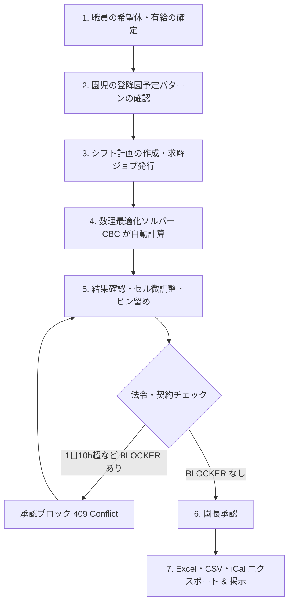

# 🧸 nusoft 総合操作・運用マニュアル (v0.4.1)

本書は、保育ICTプラットフォーム **nusoft (open-hoikuict v0.4.1)** の運用・操作マニュアルです。  
園長・施設長、主任保育士、一般保育士、事務職員、およびシステム管理者の皆様が、日々の業務で安全かつ円滑にシステムをご活用いただけるよう、実践的な手順を網羅しています。

---

## 目次

1. [はじめに & システム推奨環境](#1-はじめに--システム推奨環境)
2. [第1章: ログイン・セキュリティ・アカウント管理](#第1章-ログインセキュリティアカウント管理)
   - 2.1 ログイン手順と多要素認証 (MFA)
   - 2.2 パスワード変更とパスワード紛失時の復旧
   - 2.3 職員権限（ロール）の管理
3. [第2章: 初期設定と台帳管理](#第2章-初期設定と台帳管理)
   - 3.1 施設基本情報・開園時間・定員の設定
   - 3.2 クラス編成の登録
   - 3.3 園児・家庭台帳の登録（個別登録 & CSV一括取込）
   - 3.4 職員台帳・資格・有給休暇マスタ
4. [第3章: 日常保育業務](#第3章-日常保育業務)
   - 4.1 登降園キオスク（タッチ打刻）の運用
   - 4.2 保護者ポータルとの連携（出欠連絡・お迎え予定変更）
   - 4.3 デジタル連絡帳（記入・返信・承認）
   - 4.4 児童観察記録・保育要録（設定版楽観ロック）
   - 4.5 健康管理・身体測定・アレルギー把握
   - 4.6 お知らせ配信（Web Push通知・fail-closed配信）
5. [第4章: 職員配置基準連動 シフト自動作成 (NuShift)](#第4章-職員配置基準連動-シフト自動作成-nushift)
   - 5.1 シフト作成の全体フロー（月次・週次）
   - 5.2 職員契約・希望休・有給休暇の入力と反映
   - 5.3 求解ジョブの実行（数理最適化ソルバー）
   - 5.4 シフト結果の確認（「実行可能解」と必要配置数）
   - 5.5 セル編集と「ピン留め (Pinning)」機能による再計算
   - 5.6 労働基準法違反 (BLOCKER) と園長承認ゲート
   - 5.7 急なお迎え変更と「リアルタイム配置割れギャップ警告」
   - 5.8 掲示用 Excel 勤務割表、CSV、iCal のエクスポート
6. [第5章: 請求管理・延長保育料・全銀Zengin口座振替](#第5章-請求管理延長保育料全銀zengin口座振替)
   - 6.1 登降園実績からの延長保育料自動算出
   - 6.2 請求一覧プレビューと手動調整
   - 6.3 全銀協標準フォーマット (Zengin) 口座振替データの出力
   - 6.4 振替結果の取り込みと消込処理
7. [第6章: システム管理・バックアップ・障害復旧](#第6章-システム管理バックアップ障害復旧)
   - 7.1 機微情報アクセス監査ログの確認
   - 7.2 自動バックアップの仕組みと手動バックアップ
   - 7.3 バックアップからの復元（リストア）手順
   - 7.4 トラブルシューティング（緊急連絡先・一次切り分け）

---

## 1. はじめに & システム推奨環境

### 1.1 nusoft の思想
nusoft は、「園児と向き合うあたたかな保育の時間」を最大化するために設計されています。  
手書き書類や煩雑な計算、配置基準の複雑な確認作業をテクノロジーで自動化し、保育士の負担を劇的に軽減します。

### 1.2 推奨動作環境

| 端末区分 | 推奨環境 | 主な用途 |
| :--- | :--- | :--- |
| **事務用 PC** | Windows 10/11, macOS, Chrome / Edge 最新版 | 園長・主任・事務の管理業務、シフト作成、請求 |
| **保育室 タブレット** | iPad (iPadOS 16+), Android タブレット (10インチ以上) | 連絡帳入力、児童観察記録、園児出欠確認 |
| **玄関 キオスク端末** | Chromebook, iPad, Windows タブレット（固定設置） | 保護者・園児の登降園タッチ打刻 |
| **保護者 スマートフォン** | iPhone (iOS 15+), Android (Android 10+) | 保護者ポータル、連絡帳、出欠連絡、Web Push |

---

## 第1章: ログイン・セキュリティ・アカウント管理

### 2.1 ログイン手順と多要素認証 (MFA)
nusoft では、園児の個人情報や職員の労務情報を保護するため、**多要素認証 (MFA - メールOTP)** を採用しています。

1. **ログイン画面へアクセス**: ブラウザで `https://<自園のドメイン>/login` を開きます。
2. **IDとパスワードの入力**: 登録済みのメールアドレスとパスワードを入力し、「ログイン」をクリックします。
3. **認証コードの受信**: 登録メールアドレス宛に「【nusoft】ログイン認証コードのお知らせ」というメールが届きます（6桁の数字）。
4. **コード入力**: 画面に表示された入力枠に6桁の数字を入力し、「認証」をクリックします（有効期限は10分間です）。

> [!NOTE]
> 専用のAuthenticatorアプリ（Google Authenticator等）のインストールは不要です。スマートフォンやPCのメールさえ受信できれば、どなたでも簡単に安全なログインが可能です。

### 2.2 パスワード変更と復旧
- **パスワード変更**: 画面右上の職員名をクリック ＞「マイアカウント設定」＞「パスワード変更」から行います。
- **パスワードを忘れた場合**: ログイン画面の「パスワードをお忘れの方はこちら」をクリックし、登録メールアドレスを入力します。パスワード再設定用の一時URLがメールで届きます。

### 2.3 職員権限（ロール）の管理
職員ごとに適切な権限を設定することで、誤操作や情報の過剰閲覧を防止します。

- **園長 (Admin)**: 全機能の利用、シフトの最終承認、施設設定、バックアップ、監査ログの閲覧。
- **主任 (Chief)**: 児童記録、連絡帳承認、シフト計画の作成・求解・編集、お知らせ配信。
- **一般保育士 (Staff)**: クラス園児の出欠確認、連絡帳記入、観察記録作成、自身のシフト確認・希望休申請。
- **事務・経理 (Accountant)**: 延長保育料集計、請求管理、全銀口座振替データ出力。

---

## 第2章: 初期設定と台帳管理

### 3.1 施設基本情報・開園時間・定員の設定
メニュー「施設設定」＞「基本情報」を開きます。

1. **基本情報**: 施設名、郵便番号、住所、電話番号、認可区分を設定します。
2. **開園時間**:
   - 開園時刻（例: 07:00）および 閉園時刻（例: 20:00）
   - 保育標準時間枠（例: 07:30 〜 18:30）
   - 保育短時間枠（例: 08:30 〜 16:30）
3. **休園日**: 日曜日、祝日、年末年始（12/29〜1/3）など定期休園日を指定します。

### 3.2 クラス編成の登録
メニュー「クラス管理」から、年度ごとのクラスを登録します。
- **年齢区分**: 0歳児、1歳児、2歳児、3歳児、4歳児、5歳児
- **クラス名**: （例: ひよこ組、りす組、うさぎ組、きりん組、ぞう組）
- **定員および担当保育士**: 主担任・副担任を割り当てます。

### 3.3 園児・家庭台帳の登録
「園児台帳」メニューより、新規登録または一括CSV取込が可能です。

- **個別登録**: 氏名、生年月日、クラス、認定区分（1号・2号・3号）、標準/短時間の別、緊急連絡先、アレルギー情報を入力します。
- **一括CSVインポート**:
  1. 「CSVテンプレートをダウンロード」をクリックします。
  2. Excel 等で園児・保護者情報を入力し、CSV（UTF-8）形式で保存します。
  3. 「CSVファイルをアップロード」をクリックすると、プレビュー確認画面を経て一括登録されます。
- **保護者の招待**: 登録後、保護者のメールアドレス宛に招待メールを送信します。保護者がパスワードを設定すると、保護者ポータルが利用可能になります。

### 3.4 職員台帳・資格・有給休暇マスタ
「職員管理」メニューより、職員の基本契約と資格情報を登録します。

- **保有資格**: 保育士、看護師、子育て支援員、幼稚園教諭などの資格をチェックします（※配置基準ソルバーの計算対象判定に使用されます）。
- **雇用形態**: 常勤（フルタイム）、非常勤（パート・固定時間、シフト枠指定）。
- **有給休暇台帳**: 年次有給休暇の付与日数、残日数を管理します。有給休暇の申請・承認は、後述のシフト自動作成エンジンに自動連動します。

---

## 第3章: 日常保育業務

### 4.1 登降園キオスク（タッチ打刻）の運用
園の玄関に設置したキオスク端末（タブレット・Chromebook等）で運用します。

1. **画面表示**: キオスクモードで画面を開きます（全画面表示推奨）。
2. **打刻方法**:
   - クラスを選択し、園児の顔写真または氏名カードをタップします。
   - 「登園」または「降園」ボタンをタップすると、打刻音が鳴り完了します。
   - お迎えに来られた方（父・母・祖父母等）を選択できます。

### 4.2 保護者ポータルとの連携
保護者のスマートフォンから以下の連絡がリアルタイムに園に届きます：
- **欠席・遅刻・早退連絡**: 当日の理由と予定時刻の送信。
- **お迎え時間変更・代理お迎え**: 「予定より30分遅れる」「祖母がお迎えに行く」などの連絡。

### 4.3 デジタル連絡帳（記入・返信・承認）
1. **記入**: 保育士はクラス一覧から園児を選択し、園での様子、昼食の喫食量、お昼寝時間、排泄状況を入力します。
2. **主任・園長確認**: 提出された連絡帳は「未承認一覧」に集約されます。内容を確認し、ワンクリックで承認すると保護者ポータルへ公開されます。
3. **保護者からのコメント**: 保護者が記入した家庭での様子（朝の体温、昨晩の睡眠、連絡事項）は、出欠ボードから一覧で確認できます。

### 4.4 児童観察記録・保育要録（設定版楽観ロック）
日常のエピソード記述や、発達のチェック項目を記録します。
- **独自項目UUID**: 園の保育方針に合わせたオリジナルの観察指標（「言葉の発達」「基本的生活習慣」等）を自由に追加できます。
- **同時編集保護**: 複数担任が同時に記録を開いた場合、設定版楽観ロック (`lock_version`) により古い情報での意図しない上書きを防止します。

### 4.5 健康管理・身体測定・アレルギー把握
- **身体測定**: 毎月の身長・体重を入力すると、乳幼児発育曲線グラフに自動プロットされます。
- **アレルギー管理**: 除去品目や緊急時対応マニュアル（エピペン有無など）を顔写真付きで即座に参照できます。

### 4.6 お知らせ配信（Web Push通知・fail-closed配信）
園だよりや緊急連絡（台風による休園、不審者情報など）を配信します。
- **対象選択**: 全体、クラス指定、個別指定が可能。
- **fail-closed設計**: 入力に誤りがある場合は全園児へ誤配信されることを防ぎ、安全側に倒して配信を停止します。
- **Web Push**: 保護者のスマートフォンの画面にプッシュ通知がポップアップします。

### 4.7 YouTube簡易動画配信（クラス別視聴制限・公開期限付き）
運動会、お遊戯会、生活発表会、日頃の保育参観などの動画を、保護者ポータルへ安全に配信できます。

1. **YouTubeへの動画アップロード（事前準備）**:
   - 園のYouTubeアカウントに動画をアップロードし、公開設定を **「限定公開（リンクを知っている人のみ閲覧可能）」** に設定します。
2. **動画の新規登録（職員メニュー「動画配信管理」）**:
   - **タイトル & 説明文**: 動画のタイトル（例: 「2026年度 運動会 りす組かけっこ」）と保護者へのメッセージを入力。
   - **YouTube URL**: YouTubeの共有URL（`https://youtu.be/...` や `https://www.youtube.com/watch?v=...`）または動画IDを貼り付けます（システムが自動で動画IDを抽出・検証します）。
   - **配信対象**:
     - **全体（全学年）**: 園全体のイベント動画など、保護者全員が視聴できます。
     - **クラス限定**: 指定したクラス（例: 「ひよこ組」）に在籍する園児の保護者のみに視聴を制限します。他クラスの保護者ポータルには一覧にも表示されません。
   - **公開期間（公開日時・公開期限）**:
     - 公開期限（終了日時）を設定すると、期限到来後に保護者ポータルから自動的に非公開となり再生できなくなります。
   - **ステータス**: 「下書き」または「公開」。下書き中は職員のみプレビュー可能で、保護者には表示されません。
3. **保護者ポータルでの安全な視聴**:
   - 保護者画面のメニュー「動画配信」またはホームバナーから動画一覧を開きます。
   - 自宅のスマホやタブレットで快適にインライン再生できます。
   - Cookieを使用しない安全な埋め込みドメイン（`youtube-nocookie.com`）を採用し、保護者のプライバシーを保護。
   - 画面上には「園児のプライバシー保護のため、SNSへの無断転載・動画の保存や再配布はお控えください」とのガイダンスを明記しています。

---

## 第4章: 職員配置基準連動 シフト自動作成 (NuShift)

nusoft の最大の特徴である、**法令配置基準連動 数理最適化シフト自動作成エンジン (NuShift)** の操作手順です。

### 5.1 シフト作成の全体フロー

### 5.2 職員契約・希望休・36協定・変形労働制の設定
1. メニュー「シフト管理」＞「職員条件設定」を開きます。
2. 職員ごとに以下の条件を確認・設定します：
   - 週間契約時間、1日最大労働時間（例: 8時間）
   - **36協定の有無**: 未締結の職員は法定労働時間（1日8時間）がハード上限となり、8時間を超えるシフト作成はブロックされます。
   - **1か月単位の変形労働時間制**: 変形労働制が適用される職員は、月間法定総枠（週40時間基準）の範囲内で日・週の柔軟なシフト配分が可能になります。
   - 月間希望休（「この日は休みたい」日程）
   - 承認済み有給休暇（有給管理モジュールから自動反映されます）
   - 連続勤務日数上限（通常5日または6日）

### 5.3 求解ジョブの実行（数理最適化ソルバー & ウォームスタート）
1. 「シフト計画作成」をクリックし、対象期間（7日間〜1か月）を選択します。
2. 配置基準を選択します（例: `全国基準（厚労省）`、`東京都基準`、`福岡市基準` 等）。
3. **ソルバー選択 & パターンモード**:
   - **ソルバー選択**: 標準の `CBC` に加え、高速オープンソースソルバー `HiGHS` を選択可能（大規模月間シフトで大幅な求解高速化）。
   - **ウォームスタート（初期解投入）**: 貪欲法による暫定解を事前に投入することで、分枝限定法の計算時間を劇的に短縮します。
   - **パターンモード**: 有効にすると、出勤時の勤務枠を現場固有の定義パターン（早番・日勤・遅番等）のいずれかに完全一致させます。
4. 「最適化を実行」ボタンをクリックすると、バックグラウンドで数理モデル（MILP）が解析されます。

### 5.4 シフト結果の確認（「実行可能解」と必要配置数）
最適化が完了すると、シフトマトリクスが表示されます。
- **実行可能解 (Feasible)**: 厚労省配置基準、各職員の契約上限、希望休がすべて満たされた安全なシフトです。
- **時間帯別必要人数バー**: 各15分/30分コマごとに「必要保育士数」と「実配置数」がグラフ表示され、余剰やギリギリのコマが一目でわかります。

### 5.5 セル編集と「ピン留め (Pinning)」機能による再計算
現場の個別事情（「この日は研修があるので◯◯先生を固定したい」「行事準備のためリーダーを早番にしたい」など）に合わせて、手動でセルを調整できます。

1. 変更したいセルをクリックし、シフト枠（早番、中番、遅番、休み等）を変更します。
2. **ピン留めアイコン（📌）をクリック**: セルが「ピン留め固定」状態になります。
3. **再計算の実行**: 再び「最適化を実行」を押すと、**ピン留めされたセルはそのまま維持され**、それ以外の未固定セルのみが法令基準を満たすよう自動で再調整されます。

### 5.6 労働基準法違反 (BLOCKER) と園長承認ゲート
nusoft は保育士の健康と労働コンプライアンスを保護するため、厳格な承認ゲートを備えています。

- **BLOCKER 違反**:
  - 労働基準法第32条違反（1日10時間を超える勤務）
  - 36協定未締結者に対する1日8時間超の残業
  - 保育士配置基準割れ（必要人数を下回るコマが存在する）
- **承認ゲート**:
  - BLOCKER が1件でも残っている場合、園長承認ボタンは無効化され、承認を実行しようとしても `409 Conflict` でシステムが遮断します。
  - 要調整（WARNING: 連続勤務日数の超過、休憩不足等）がある場合は、内容を確認の上で園長判断による承認が可能です。

### 5.7 急なお迎え変更と「リアルタイム配置割れギャップ警告」
保護者が夕方のお迎え予定を延長した場合、バックエンドの `gap_analysis` エンジンが即座に連動します。
- **配置割れ警告バナー**: シフト画面上部に赤色のバナーが表示され、「17:30〜18:00 に保育士が1名不足しています」と具体的なギャップを提示します。
- 現場は直ちにパート職員の延長要請や応援配置を行い、基準違反を未然に防ぐことができます。

### 5.8 掲示用 Excel 勤務割表、現場シフト記号マトリクス、割増給与計算 CSV のエクスポート
承認が完了したシフトは、ワンクリックで各種形式に出力できます：
- **現場用シフト記号マトリクス (`symbol_matrix.csv` / Excel「現場シフト記号」シート)**: 園で親しまれている「早」「日」「遅」「休」「A」などの記号で職員別・日付別の勤務が一覧できる現場掲示用マトリクス。
- **法定割増給与計算表 (`payroll.csv`)**: 所定内労働時間に加え、時間外（25%割増）、深夜22:00〜5:00（25%割増）、法定休日（35%割増）の割増賃金シミュレーションを同梱。
- **Excel 勤務割表 (`shift.xlsx`)**: 職員室の壁にそのまま貼り出せる、A3/A4対応の美しいレイアウト。資格種別・日別勤務時間・免責文言付き。
- **iCalendar (`shift.ics`)**: Google カレンダーや iPhone カレンダーへ一括取り込みできるスケジュールファイル。

---

## 第5章: 請求管理・延長保育料・全銀Zengin口座振替

### 6.1 登降園実績からの延長保育料自動算出
毎月末の締め日に、「請求管理」＞「延長保育料集計」を開きます。
- 登降園キオスクの打刻実績に基づき、各園児の「標準時間外」「短時間外」の利用実績を15分/30分単位で自動集計します。
- 月極契約の園児には定額料金を、スポット利用の園児には回数/時間に応じた従量料金を自動適用します。

### 6.2 請求一覧プレビューと手動調整
- 集計結果が一覧表示され、園児ごとに明細（基本保育料、給食費、延長保育料、教材費等）を確認できます。
- 事情による割引や臨時費用の追加がある場合、画面上から明細の修正が可能です。

### 6.3 全銀協標準フォーマット (Zengin) 口座振替データの出力
1. 「全銀データ生成」をクリックします。
2. 委託者コード、振替指定日（例: 翌月10日）を確認します。
3. **データ出力**: 全銀協規定に完全準拠した固定長テキストファイル（全銀フォーマット）がダウンロードされます。
4. **ネットバンキングへの取込**: 各金融機関（みずほ、三菱UFJ、三井住友、ゆうちょ、地方銀行、信用金庫等）のビジネスWebバンキングの「口座振替データ伝送」メニューから、出力ファイルをそのままアップロードします。

### 6.4 振替結果の取り込みと消込処理
後日、金融機関からダウンロードした「振替結果ファイル」を nusoft にアップロードすることで、入金消込が自動完了します。振替不能（残高不足等）の園児は一覧で赤色表示され、再請求や現金回収の管理が容易に行えます。

---

## 第6章: システム管理・バックアップ・障害復旧

### 7.1 機微情報アクセス監査ログの確認
システム管理者メニュー「監査ログ」から、以下のセキュリティイベントを検索・閲覧できます：
- ログイン成功/失敗、MFAコード検証
- 園児・保護者の個人情報閲覧およびエクスポート履歴
- 口座番号などの金融情報の変更履歴
- シフトの承認・改ざん防止ログ

### 7.2 自動バックアップの仕組みと手動バックアップ
- **自動日次バックアップ**: 毎深夜に自動的にデータベースのスナップショットが作成され、世代管理されます。
- **整合性検証 (Backup Contract)**: スキーマ契約ファイルと突合し、破損や欠損のない完全なバックアップであることを自動検証します。
- **手動バックアップ**: バージョンアップ作業前や月次締め処理前には、「システム設定」＞「バックアップ作成」から即座に手動保存が可能です。

### 7.3 バックアップからの復元（リストア）手順
万が一のサーバー障害やデータ誤削除に備え、メンテナンスモード制御下でのアトミック復元が可能です。
1. 「メンテナンスモード」を有効化し、一般ユーザーのアクセスを一時停止します。
2. 復元対象のバックアップ世代を選択します。
3. 「復元を実行」をクリックします。整合性チェックを経て安全にリストアされ、完了後にメンテナンスモードが自動解除されます。

### 7.4 トラブルシューティング

| 症状 | 考えられる原因 | 対処方法 |
| :--- | :--- | :--- |
| **MFAメールが届かない** | 迷惑メールフォルダへの振分け、アドレス誤登録 | 迷惑メールを確認。管理者に連絡し、職員台帳のメールアドレス設定を確認・再送。 |
| **シフト作成でエラーが出る** | 職員数が不足している、条件が厳しすぎる | 園児数に対して出勤可能な保育士数が絶対的に不足していないか確認。制約条件を緩和して再計算。 |
| **シフト承認ボタンが押せない** | BLOCKER 違反（1日10h超など）が残っている | 違反一覧を確認し、該当セルの勤務時間を調整するか、ピン留めを外して再計算。 |
| **全銀データのアップロードで銀行エラー** | 委託者コードや支店番号の不一致 | 施設設定の銀行情報・口座番号の桁数（7桁ゼロ埋め等）を再確認して再出力。 |

---

*本書の内容は nusoft v0.4.1 に基づいています。機能追加や仕様改善により、一部画面表記が更新される場合があります。*
