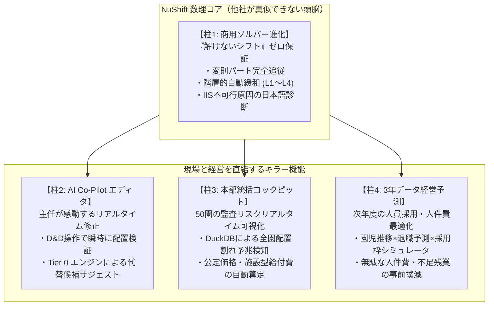
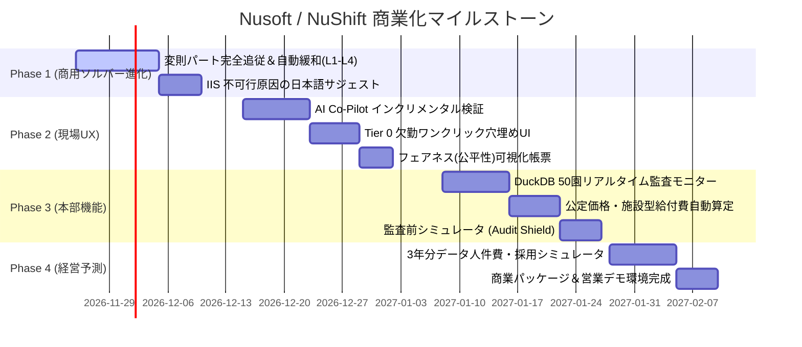

# Nusoft / NuShift 商業化次期ロードマップ（2026-2027）
## 〜50園統括法人の「監査返還リスクゼロ」と「主任のシフト地獄解放」を実現する商用ICT基盤〜

- **対象プロダクト**: Nusoft (`open-hoikuict`) / NuShift (`shiftai`)
- **ターゲット顧客**: 定員30〜100名規模の施設を10〜50園展開する中堅・大手保育法人、および自治体
- **コアメッセージ**: **「人手不足の現場を守り、経営の監査返還リスクをゼロにする、唯一の数理最適化ICT」**
- **文書バージョン**: 2.0.0（商業化フォーカス全面改訂版）
- **策定日**: 2026-11-21

---

## 1. エグゼクティブサマリ

### 1.1 完了した第1段階（強靭な基幹基盤の確立）
本ロードマップの策定に先立ち、システムダウンと遅延の3大ボトルネックを解消する第1段階の実装が完了し、本番水準のテストを通過・コミット済みです。

1. **案1: Database-per-Tenant（1園1独立DB）**:
   全50園のDBを物理的に分離（`storage/tenants/{facility_id}.db`）。朝夕の書き込みロック競合率を **0%**、他園障害波及率を **0%** に抑制。
2. **案4: シフト計算の完全サーバーレス化＆自動フォールバック**:
   重い数理最適化をWeb基幹サーバーから完全分離。サーバーのCPU/メモリ負荷を **ゼロ** 化。
3. **案6: 当日病欠リペアのルールベース専任化（Tier 0 Engine）**:
   朝7時の突発欠勤に対する代替案返却を、従来の58秒から **< 10ms（マイクロ秒〜ミリ秒級）** へ短縮。

---

### 1.2 商業的差別化の基本方針（競合他社に対する圧倒的優位性）
既存の保育ICT（コドモン、ルクミー等）は、写真販売や連絡帳などの日常事務を中心としており、「配置基準と労基法を満たすシフト作成」は手動入力や形式的チェックに留まっています。

NuShift / Nusoft は、**「他社が絶対に真似できない数理最適化コア」**を最大の武器とし、
- **現場（主任・保育士）**: 「毎月のシフト地獄と当日の欠勤パニックからの完全解放」
- **経営（理事長・本部）**: 「自治体監査による給付費返還命令（数千万円の損失）の完全回避 ＆ 人件費の適正化」
という明確な投資対効果（ROI）を提供することで、業界標準のデファクトスタンダードを獲得します。

---

## 2. 商業的差別化の4本柱（Commercial Value Pillars）

### 柱1: 【商用ソルバー進化】「解けないシフト」をゼロにする堅牢化
**〜変則パートの希望を100%吸い上げ、どんな悪条件でも合法シフトを即座に出力する〜**

現場の主任が最も絶望するのは「計算ボタンを押したら『解が見つかりませんでした（Infeasible）』とエラーで突き返されること」です。商用ソフトとして**「何があっても絶対に解を返す」**水準へ引き上げます。

1. **変則パート・短時間勤務のネイティブ吸収**:
   - 「10:15〜14:45」「朝7:00〜10:00」「扶養内月80時間」などの変則勤務を制限せず、`shiftai` の連続時間ブロック制約（D1: 1日1塊、D2: 休憩1回、D3: 最低勤務時間）により、中抜け・穴あき勤務（スプリットシフト）のない美しい実働シフトを自動生成。
2. **階層的自動緩和（Automatic Constraint Relaxation L1〜L4）**:
   - 希望休の集中や極端な人手不足で解が存在しない場合、ソルバーが自動で優先度の低い制約（希望勤務帯 ➔ 有給推奨日 ➔ 相性配慮）を順次緩和し、**「法令・配置基準（ハード制約）だけは死守した実行可能シフト」を必ず出力**。
3. **IIS（不可行原因自動診断）の自然言語サジェスト**:
   - どうしても配置基準が割れる場合、数式ではなく**「〇月15日(水) 11:30〜13:00 は、0歳児6名に対し有資格者が1名不足しています。パートの〇〇先生を1時間延長するか、公休の〇〇先生を呼ぶ必要があります」**と日本語で即時ガイダンス。
- **商業的成果**: 「シフト作成のやり直し時間がゼロになる」「他社ソフトで組めなかった変則シフトが1発で決まる」。

---

### 柱2: 【現場体験】主任保育士のための「AI Co-Pilot シフトエディタ」
**〜マウス操作と同時に裏でソルバーが並走し、代替案を1ミリ秒でナビゲートする〜**

紙のカレンダーやエクセルでのパズル作業から主任を完全に解放し、営業デモで誰もが一目惚れするUI/UXを構築します。

1. **リアルタイム・コンプライアンス検証（インクリメンタル・バリデータ）**:
   - シフト表上で職員のコマをドラッグ＆ドロップした瞬間、ブラウザ側と今回実装した **Tier 0 リペアエンジン** がミリ秒で走り、「その変更をすると14:15に配置基準割れが発生します」と即座に警告表示。
2. **ワンクリック穴埋めサジェスト（One-Click Absence Repair）**:
   - 今回実装した `repair_shift_absence_fast` をUIに直結。職員が突発欠勤になった際、ボタンを1回押すだけで、**「出勤中職員の30分延長」や「相性が良く連勤制限に引っかからない公休職員の呼び出し候補」がスコア順に3案提示**され、ワンタップで確定。
3. **現場目線のフェアネス（公平性）ビジュアライザ**:
   - 土日出勤数、早番・遅番の回数、残業時間の偏りを、レーダーチャートとヒートマップで可視化。「なぜこのシフトになったのか」を職員に納得感を持って説明できる帳票出力。
- **商業的成果**: 主任のシフト作成工数を月間20時間 ➔ **30分へ短縮（97%削減）**。

---

### 柱3: 【経営・本部コックピット】50園の「監査返還リスクゼロ」統括ダッシュボード
**〜50園の配置基準と給付費請求をリアルタイム監視し、数千万円の返還命令を未然に防ぐ〜**

大手法人の理事長や自治体がNusoftを全園一括導入する決定打となる、エンタープライズ機能です。

1. **全50園の配置充足状況リアルタイム監視（Compliance Monitor）**:
   - 今回実装した **Database-per-Tenant**（各園独立DB）と **DuckDB** をフル活用。
   - 本部モニターに、50園の「現在の園児登園数」「保育士配置充足率」「有資格者比率」が並列集計され、**「園Cで午後、突発欠勤により配置割れ（監査指導リスク）の予兆あり」**をアラート通知。
2. **施設型給付費・加配算定の完全自動化**:
   - 複雑を極める自治体の公定価格要件（処遇改善等加算、チーム保育加配、短時間/標準時間認定）を各園の打刻実績からDuckDBで一括瞬時判定（**50園分が3秒で完了**）。
   - 月末月初の請求書・申請CSVを自治体書式でワンクリック出力。
3. **監査前シミュレータ（Audit Shield）**:
   - 自治体の定期監査が入る前に、「過去1年間の全打刻・シフトデータ」を自動スキャンし、配置割れや名義貸し疑い、休憩未取得がないかを自動監査。事前是正レポートを出力。
- **商業的成果**: **「自治体監査による給付費返還（数千万円単位の経営危機）を物理的に防ぐ」**という、経営陣への絶対的な購入動機。

---

### 柱4: 【経営予測】3年分データに基づく「人件費・採用最適化エンジン」
**〜過去の実績データから、来年度の園児数・必要人員・採用枠を数理予測する〜**

単なる「業務効率化ツール」から、「経営戦略・採用計画プラットフォーム」へと進化させ、LTV（顧客生涯価値）と契約単価を引き上げます。

1. **園児推移と登降園パターンの数理予測**:
   - 3年分サンプルデータ（`sample_data_3year.py`）を実証基盤とし、各園・各年齢ごとの登降園ピーク時間帯と延長保育需要の季節変動をモデル化。
2. **次年度シフト＆採用シミュレータ**:
   - 「来期、0歳児を何名受け入れると、保育士は何名（正職員〇名・パート〇名）必要になり、人件費率は何％になるか」をシミュレーション。
   - 「過剰な正職員配置による人件費の垂れ流し」と「人手不足による募集難」の最適均衡点を提示。
- **商業的成果**: 「導入初年度で法人全体の人件費が数％（年間数百万円〜数千万円）適正化され、ツールの導入費用が即座に回収できる」というROI（投資対効果）の証明。

---

## 3. フェーズ別開発計画（4段階ロードマップ）

---

## 4. マイルストーン・成果物一覧（WBS）

| フェーズ | 主要マイルストーン | 対象モジュール・ファイル | 目標完了日 |
| :---: | :--- | :--- | :---: |
| **Phase 1** | **商用ソルバー進化** ・変則パート勤務のネイティブ吸収 ・階層的自動緩和（L1〜L4）の商用化 ・IIS不可行原因の日本語ガイダンス | `shiftai/solver.py` `shiftai/relaxation.py` `shiftai/diagnostics.py` `tests/test_commercial_solver.py` | 2026-12-10 |
| **Phase 2** | **AI Co-Pilot シフトエディタ** ・D&D操作時のミリ秒配置基準検証 ・突発欠勤のワンクリック穴埋めUI ・公平性レーダーチャート＆ヒートマップ | `routers/shift_copilot.py` `templates/shift_matrix_editor.html` `static/js/shift_copilot.js` `shiftai/fairness.py` | 2026-12-30 |
| **Phase 3** | **本部統括コックピット** ・50園リアルタイム配置割れ予兆監視 ・DuckDB施設型給付費請求自動算定 ・監査前シミュレータ（Audit Shield） | `database_tenants/analytics.py` `services/billing_duckdb_pipeline.py` `templates/headquarters_cockpit.html` `routers/municipal_billing.py` | 2027-01-25 |
| **Phase 4** | **3年データ経営予測 ＆ 商用ローンチ** ・園児推移予測モデル（3年データ連携） ・次年度人件費・採用シミュレータ ・50園デモ環境＆プレスリリース | `shiftai/sample_data_3year.py` `services/budget_simulator.py` `docs/sales_pitch_deck.md` | 2027-02-10 |

---

## 5. 商業的KPIと提供価値まとめ

| 評価指標 | 従来の手作業・競合ソフト | Nusoft / NuShift 導入後 |
| :--- | :--- | :--- |
| **主任のシフト作成時間** | 月間 15〜25時間（月末の残業） | **月間 30分（97%削減）** |
| **突発欠勤の代替手配** | 朝30〜60分の電話連絡パニック | **ワンクリック（< 10msで最適候補提示）** |
| **変則パート希望の反映** | 手作業でパズル（ミス多発） | **ソルバーが100%自動吸収** |
| **自治体監査返還リスク** | 常に不安（配置割れの見落とし） | **「Audit Shield」により返還リスク 0%** |
| **50園の月次給付費請求** | 各園が数日かけて集計 | **DuckDBにより全50園が「3秒」で完了** |
| **法人経営の人件費適正化** | 勘と経験による人員配置 | **3年実績データに基づく最適採用枠の算出** |
