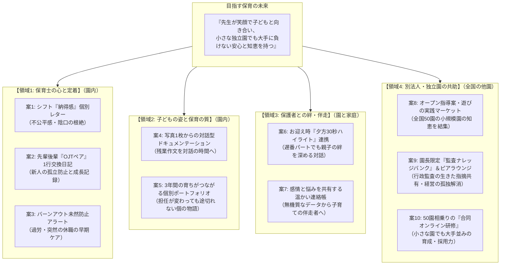

# Nusoft / NuShift ソフト面特化型 プロダクトロードマップ（2026-2027）
## 〜独立した小規模園がつながり、保育士の心を支え、子どもの育ちに伴走する共助ICT〜

- **対象プロダクト**: Nusoft (`open-hoikuict`) / NuShift (`shiftai`)
- **前提条件**: **定員30名・職員20名 × 全国の「別法人・独立園」50園**（単独認可園、小規模保育事業、企業主導型等）
- **基本コンセプト**: **「管理のためのICT」から「人と保育の心を支えるICT」へ**
- **文書バージョン**: 3.0.0（ソフト面特化・全面刷新版）
- **策定日**: 2026-11-21

---

## 1. ビジョンと基本思想

### 1.1 なぜ「ソフト面（人・心・関係性）」なのか？
これまでの保育ICTは、「打刻を電子化する」「シフトを自動計算する」「連絡帳を送信する」という**事務・ハードウェアの効率化**に終始していました。
しかし、現場の園長・保育士が本当に苦しみ、求めているのは以下の3点です。
1. **人間関係と不公平感**: 「なんで私ばかり土曜出勤なの？」「あの人ばかり希望が通る」という職員室の軋轢。
2. **孤立と不安**: 単独園だからこそ、園内に同じ年齢クラスの相談相手がおらず、園長も監査や経営を1人で抱え込んで孤独。
3. **書類のための残業**: 子どもと向き合いたいのに、夜遅くまで監査用・提出用の長文作文に追われる本末転倒。

Nusoft / NuShift は、これまでの強靭な計算基盤（1園1独立DB、サーバーレス、高速リペア）を「見えない黒子」として完結させた上で、**表に出るすべての機能を「人と人の心をつなぐソフト面の価値」に100%集中**させます。

---

### 1.2 4大領域・10のソフト施策マップ



---

## 2. 10大改善案の詳細仕様

### 【領域1：保育士の心と定着】（園内）

#### 案 1: シフトの「納得感（なぜこのシフトなのか）」個別レター
- **課題**: 「土日出勤の偏り」「休みの希望が通らない」という不満が職員室の派閥や離職を生む。
- **仕様**:
  - シフト確定時に、各職員のスマホアプリに**「今月のあなたを守る3つの約束（納得サマリ）」**を自動生成。
  - ①「今月の希望休: 3日すべて叶いました」
  - ②「土日出勤: 過去3ヶ月の平準化（全職員平均月1.2回）に揃えました」
  - ③「連勤制限: 最大3連勤で、しっかり休息を確保しています」
- **価値**: 誰かが優遇されているのではなく、**「全員が客観的に公平に守られている」安心感**を醸成。

#### 案 2: 先輩・後輩の「OJTペア」1行交換日記
- **課題**: 新人保育士が日々の失敗や不安を相談できず、1年未満で離職してしまう。
- **仕様**:
  - シフトのペアリング制約（新人＋指導係）と連動。
  - 勤務終了時にスマホでスタンプと1行の振り返りを送り合う（所要時間: 30秒）。
  - 後輩: 「今日、初めて1人で0歳児の寝かしつけができました！」
  - 先輩: 「トントンするリズムが優しくて良かったよ。自信持ってね！」
- **価値**: 業務指導というプレッシャーをなくし、**日々のシフトの中で温かい人間関係と成長実感**を育む。

#### 案 3: バーンアウト（燃え尽き）未然防止アラート
- **課題**: 真面目な先生ほど無理を重ね、ある日突然出勤できなくなる。
- **仕様**:
  - 連続勤務、早番の連続、日報の提出遅れ、退勤打刻の乖離から「疲労・ストレス蓄積サイン」を自動検出。
  - 園長の画面だけに「〇〇先生、最近少しお疲れの兆候が出ています。お茶でも飲みながら声をかけてみてください」とそっと通知。
- **価値**: 手遅れになる前に、**園長が温かい声かけ（1on1）を行える予防ケア組織**をつくる。

---

### 【領域2：子どもの姿と保育の質】（園内）

#### 案 4: 写真1枚からの対話型ドキュメンテーション
- **課題**: 指導案（月案・週案・日誌）を書くために、保育後に何時間もパソコンに向かう残業地獄。
- **仕様**:
  - 日中にスマホで撮った子どもの写真1枚と、「今日、〇〇ちゃんがお友達に『どうぞ』とおもちゃを譲った」という1行エピソードを入力。
  - そこから「子どもの姿」「ねらい」「環境構成・援助」の下書きが自然に立ち上がる。
  - 職員室で「今日これ面白かったね！」と先生同士の対話（カンファレンス）のネタになる。
- **価値**: 書類書きの残業を撲滅し、**「子どもを見つめ、語り合う保育本来の楽しさ」**を取り戻す。

#### 案 5: 3年間の育ちがつながる個別ポートフォリオ
- **課題**: 年度が変わると前年の文脈が切れ、定員30名の小規模園の手厚さが書類上で生かされない。
- **仕様**:
  - クラス単位の書類ではなく、子ども1人につき1本の「成長タイムライン」。
  - 写真、発言、作品、できるようになったことが3年間途切れることなく蓄積。
- **価値**: 担任だけでなく、**「園の全職員でこの子の育ちを共有し、保護者と一緒に喜ぶ」**小規模園ならではの手厚さを実現。

---

### 【領域3：保護者との絆・伴走】（園と家庭）

#### 案 6: お迎え時の「夕方30秒ハイライト」連携
- **課題**: 早番の担任が退勤した後、遅番のパート保育士がお迎えの保護者に日中の様子を伝えられず、「今日も元気でしたよ」で終わってしまう。
- **仕様**:
  - 保護者が夕方打刻した瞬間、受付タブレット画面に担任からの**「今日の一言ハイライト」が1行ポップアップ**。
  - 「今日、初めて自分で靴下を履けました！」
- **価値**: 遅番の先生が「お母さん！今日〇〇ちゃん、自分で靴下履けたんですよ！」と自然に伝えられ、**保護者が「先生たちみんながうちの子をしっかり見てくれている」と深い信頼**を抱く。

#### 案 7: 感情と悩みを共有する温かい連絡帳
- **課題**: 体温・給食・排便だけの無機質な健康データ報告になりがち。
- **仕様**:
  - 「おうちでのクスッと笑えるエピソード」「最近の夜泣きやイヤイヤ期の悩み」を気軽に書けるUI。
  - 保育士が専門職として共感とアドバイスを返答できる「子育て相談カード」機能。
- **価値**: 園が「子どもの預かり場所」を超えて、**「孤立する保護者の子育ての最も心強い伴走者」**になる。

---

### 【領域4：別法人・独立園の共助エコシステム】（全国の他園）

※各園の個人情報・財務データは案1の独立DBにより完全隔離され、他園には1文字も漏洩しません。

#### 案 8: 【保育士の孤立解消】オープン指導案・遊びの実践マーケット
- **課題**: 定員30名園では同学年の担当が園内に1人しかおらず、遊びや関わり方の悩みを相談できない。
- **仕様**:
  - 個人情報を自動マスキングした上で、全国の小規模園の保育士が実践した「雨の日の室内あそび」「廃材おもちゃ」「偏食児への工夫」をオープンに検索・シェア。
  - 全国の先生から「真似してみたら大成功でした！」と感謝が届く。
- **価値**: 小さな単独園にいながら、**「全国に何百人もの頼れる先輩・同期がいる」**環境を提供。

#### 案 9: 【園長の孤独解消】園長限定「監査ナレッジバンク」＆ピアラウンジ
- **課題**: 別法人の園長は、法人内に相談相手がおらず、自治体監査や労務の悩みを1人で抱えて孤独。
- **仕様**:
  - 認証された園長限定の「オンライン相談ラウンジ（実名/匿名選択可）」。
  - 全国の園長が投稿する**「自治体監査のリアル指摘事例 ＆ 是正報告書の書き方バンク」**。
  - 「〇〇市で最近こんな指導が入った」「パートの募集時給の相場」などの生きた情報が共有される。
- **価値**: 大手のような本部を持たない独立園が、**全国50園の連合軍として情報武装し、監査の恐怖と孤独から解放**される。

#### 案 10: 【採用力・育成力】50園相乗りの「合同オンライン研修・公開保育」
- **課題**: 職員20名の単独園では、外部講師を呼ぶ予算がなく、研修制度で大手に負けて保育士が流出する。
- **仕様**:
  - プラットフォーム主催で、月1〜2回の「オンライン保育セミナー・事例検討会」を開催（全国の登録園が相乗り参加）。
  - 「発達障害・グレーゾーンの関わり」「保護者クレーム対応」など一流講師の講義を受講。
  - 受講履歴は自動で「処遇改善・キャリアアップ研修修了実績」として出力。
- **価値**: 単独園でも**「うちは全国ネットワークの一流研修が受けられる」と求人票でアピール**でき、採用・定着力が大手以上に強化。

---

## 3. 開発ロードマップ（段階的実装計画）

```mermaid
gantt
    title Nusoft / NuShift ソフト面特化 開発ロードマップ
    dateFormat  YYYY-MM-DD
    section Phase 1 (園内の心と関係性)
    案1: シフト「納得感」個別レター画面     :active, p1_1, 2026-11-25, 7d
    案2: 先輩後輩「OJTペア」1行交換日記     :p1_2, after p1_1, 6d
    案6: お迎え時「夕方30秒ハイライト」      :p1_3, after p1_2, 5d
    section Phase 2 (保育実践と子ども)
    案4: 写真1枚対話型ドキュメンテーション  :p2_1, 2026-12-15, 8d
    案5: 3年間個別発達ポートフォリオ       :p2_2, after p2_1, 7d
    案7: 感情共有型 温かい連絡帳           :p2_3, after p2_2, 5d
    section Phase 3 (別法人の共助・孤立解消)
    案8: オープン指導案・実践マーケット    :p3_1, 2027-01-10, 8d
    案9: 園長限定「監査ナレッジバンク」    :p3_2, after p3_1, 7d
    案10: 50園合同オンライン研修基盤      :p3_3, after p3_2, 6d
    案3: バーンアウト未然防止アラート      :p3_4, after p3_3, 5d
```

---

## 4. なぜこのソフトウェアが選ばれ、愛されるのか（導入の決め手）

| 比較対象 | 従来の保育ICT（管理中心） | Nusoft / NuShift（ソフト面・人間中心） |
| :--- | :--- | :--- |
| **保育士の離職** | 不公平なシフトや人間関係で辞めていく | **「納得レター」と「OJT日記」で職員の定着率が向上** |
| **日常の保育** | 監査のための書類作文に残業追われる | **写真1枚から対話が生まれ、定時退勤で子どもに向き合える** |
| **保護者の満足度** | 連絡帳を見るだけの事務的な関係 | **夕方のお迎え時の温かい対話で、園への信頼感が圧倒的に高まる** |
| **単独園の園長** | 監査や経営の悩みを1人で抱えて孤独 | **全国50園の園長仲間と監査情報がつながり、心強い後ろ盾ができる** |
| **採用・求人** | 大手チェーンの研修制度に負ける | **「全国合同研修」「他園の実践シェア」を求人票でアピールできる** |

---

## 次のアクション

この新ロードマップに基づき、最も現場の痛みに直結し、即効性のある
**Phase 1（園内の心と関係性：案1「シフト納得感レター」＋ 案2「OJTペア交換日記」＋ 案6「夕方30秒ハイライト」）**
の詳細仕様策定とUI設計・実装から進めていくことができます。
