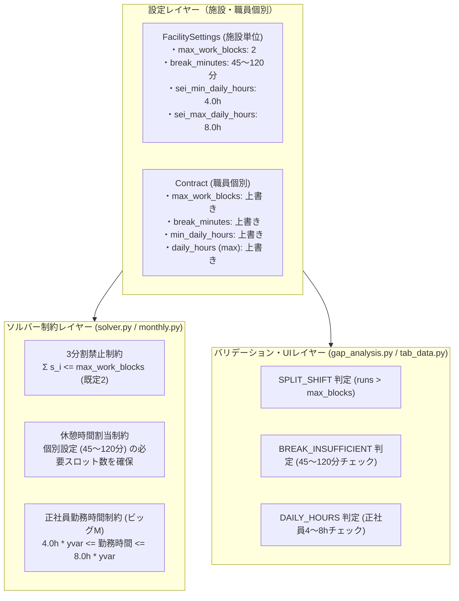

# 勤務時間3分割禁止・休憩時間45〜120分調整・正社員4〜8時間勤務 柔軟化 詳細実装計画書

- **作成日**: 2026-11-14
- **対象プロジェクト**:
  - `NuShift` (`E:\nushift\nushift`) — ソルバー・ドメイン・UI
  - `open-hoikuict` (`C:\Users\user\openict\open-hoikuict`) — vendor 同期

---

## 1. 要件と設計方針

### 1.1 要件の整理
1. **勤務時間を3分割する方法を基本的に禁止**:
   - 1日の勤務ブロックが3個以上（例: 勤務→中抜け→勤務→中抜け→勤務）になる「3分割勤務」を基本的に禁止する。
   - 通常の勤務形態（1連続勤務、または途中に1回休憩を挟む2ブロック勤務）は許容し、3分割以上を構造的に排除する。
2. **休憩時間を45〜120分で調整可能とする**:
   - 労働基準法第34条（6時間超45分、8時間超60分）の法定要件を満たした上で、45分〜120分の範囲で設定できるようにする。
3. **正社員（常勤）の勤務時間を4〜8時間の間で調整可能とする**:
   - 正社員（`EmploymentType.SEI`）について、出勤する日の勤務時間を従来の8時間固定から、需要に応じた「4時間〜8時間（半日〜全日）」の柔軟な範囲で割り当てられるようにする。
4. **施設や職員ごとに調整可能とする**:
   - **施設単位（FacilitySettings）**: 園全体の標準ポリシーとして設定。
   - **職員・契約単位（Contract）**: 職員ごとの個別雇用契約に応じた上書き設定を可能にする。
   - **優先順位**: 職員契約 (`Contract`) > 施設設定 (`FacilitySettings`) > 制度プリセット (`StandardRule`) > システム既定 (`config`)。



---

## 2. データ構造の拡張 (`domain.py`, `config.py`)

### 2.1 定数の追加 (`config.py`)
```python
MIN_ALLOWABLE_BREAK_MINUTES = 45     # 労基法最低休憩（6時間超）
MAX_ALLOWABLE_BREAK_MINUTES = 120    # 許容最大休憩（2時間）
DEFAULT_MAX_WORK_BLOCKS = 2          # 1日最大勤務ブロック数（3分割禁止のため既定2）
DEFAULT_SEI_MIN_DAILY_HOURS = 4.0    # 正社員最低勤務時間（4時間）
DEFAULT_SEI_MAX_DAILY_HOURS = 8.0    # 正社員最高勤務時間（8時間）
```

### 2.2 `FacilitySettings` の拡張 (`domain.py`)
```python
@dataclass(frozen=True)
class FacilitySettings:
    ...
    # 新規追加項目
    max_work_blocks_per_day: int = config.DEFAULT_MAX_WORK_BLOCKS
    """1日の最大勤務ブロック数。``2`` は休憩1回を挟む2分割までを許容し、3分割以上を禁止する。"""
    break_minutes: int = config.DEFAULT_BREAK_MINUTES
    """園の標準休憩時間（45〜120分）。"""
    sei_min_daily_hours: float = config.DEFAULT_SEI_MIN_DAILY_HOURS
    """正社員の1日最低勤務時間（時間）。"""
    sei_max_daily_hours: float = config.DEFAULT_SEI_MAX_DAILY_HOURS
    """正社員の1日最高勤務時間（時間）。"""
```

### 2.3 `Contract` の拡張 (`domain.py`)
```python
@dataclass(frozen=True)
class Contract:
    weekly_hours: float
    daily_hours: float  # 最高勤務時間（max_daily_hours）としても機能
    employment_type: EmploymentType = EmploymentType.PART
    ...
    # 新規追加項目
    min_daily_hours: float | None = None
    """1日最低勤務時間。正社員で未指定の場合は 4.0 時間が適用される。"""
    break_minutes: int | None = None
    """職員個別の休憩時間（45〜120分）。未指定時は施設設定または基準値が適用される。"""
    max_work_blocks_per_day: int | None = None
    """職員個別の1日最大勤務ブロック数。未指定時は施設設定が適用される。"""
```

---

## 3. 数理最適化ソルバーの定式化 (`solver.py`, `monthly.py`)

### 3.1 勤務時間3分割の禁止（最大ブロック数制約）
- **定式化**:
  1日の各スロット $i \in \{0, \dots, n-1\}$ に対し、勤務開始フラグ $s_i \in \{0, 1\}$ を設置：
  $$s_i \ge w_i - w_{i-1} \quad (w_{-1} = 0)$$
  1日の総勤務ブロック数 $\sum_{i=0}^{n-1} s_i$ に対し、以下を課す：
  $$\sum_{i=0}^{n-1} s_i \le \text{max\_blocks} \quad (\text{既定: } 2)$$
- これにより、1日の勤務は「高々2ブロック（途中に1回休憩を挟む形）」に制限され、**3分割（3ブロック以上）は自動的に排除**されます。

### 3.2 休憩時間（45〜120分）の職員・施設別割当
- 職員 $sid$ の適用休憩時間 $\text{eff\_break}$ を解決：
  $$\text{eff\_break} = \text{st.contract.break\_minutes} \lor \text{settings.break\_minutes} \lor \text{standard.break\_minutes}$$
  （45分〜120分の範囲にクランプ）
- 必要休憩スロット数：
  $$\text{need\_slots} = \max(1, \lceil \text{eff\_break} / \text{granularity\_min} \rceil)$$
- 出勤日（$yvar_{sid, day} = 1$）に対し、個別設定に応じた $\text{need\_slots}$ の休憩を確保：
  $$\sum_{i} b_{sid, day, i} \ge \text{need\_slots} \cdot yvar_{sid, day} - \text{deficit}$$

### 3.3 正社員の4〜8時間勤務調整（ビッグM定式化）
- 正社員（`st.contract.employment_type == EmploymentType.SEI`）に対し：
  $$\text{min\_min} = (\text{st.contract.min\_daily\_hours} \lor \text{settings.sei\_min\_daily\_hours} \lor 4.0) \times 60$$
  $$\text{max\_min} = (\text{st.contract.daily\_hours} \lor \text{settings.sei\_max\_daily\_hours} \lor 8.0) \times 60$$
- 出勤フラグ $yvar \in \{0, 1\}$ と日次勤務分数 $W_{sid, day} = \sum_i w_i \cdot \text{slot\_minutes}$ の間に以下を課す：
  $$W_{sid, day} \ge \text{min\_min} \cdot yvar_{sid, day}$$
  $$W_{sid, day} \le \text{max\_min} \cdot yvar_{sid, day}$$
- **効果**:
  - $yvar = 0$（公休・非番）のとき: $0 \le W_{sid, day} \le 0 \implies W = 0$
  - $yvar = 1$（出勤日）のとき: $\text{min\_min} \le W_{sid, day} \le \text{max\_min}$（4.0h〜8.0h）

---

## 4. バリデーションとUIの拡張

### 4.1 `gap_analysis.py` / `live_validation.py`
1. **3分割禁止判定 (`SPLIT_SHIFT`)**:
   - `runs > max_blocks`（設定値、既定2）のとき、`SPLIT_SHIFT` 違反を発行。
2. **休憩時間判定 (`BREAK_INSUFFICIENT`)**:
   - 職員個別設定または施設設定の目標休憩時間（45〜120分）、および法定下限（45分/60分）と比較して不足を警告。
3. **正社員勤務時間判定 (`DAILY_HOURS_SHORT` / `DAILY_HOURS_EXCEEDED`)**:
   - 正社員で勤務時間が 4 時間未満の場合、新設の警告 `DAILY_HOURS_SHORT` を発行。

### 4.2 UI設定画面 (`tab_data.py`)
- 施設設定エクスパンダーに「休憩時間（45〜120分）」「正社員の勤務時間範囲（4〜8時間）」「1日の最大勤務ブロック数（既定2）」の入力UIを追加。
- 職員CSV / 職員編集フォームに個別の上書きフィールドを対応。

---

## 5. ベンダー同期とテスト計画

1. **NuShift 単体テスト**:
   - `tests/test_flexible_hours_and_breaks.py`:
     - 施設・職員契約データ構造拡張とバリデーション範囲テスト
     - 3分割勤務検出（`SPLIT_SHIFT`）テスト
     - 正社員出勤日4時間未満警告（`DAILY_HOURS_SHORT`）テスト
     - 正社員出勤日上限超過警告（`DAILY_HOURS_EXCEEDED`）テスト
     - ソルバーによる個別休憩時間（90分）および正社員4〜8h割当テスト
     - 施設設定（休憩90分、正社員5〜7h）のソルバー反映テスト
     - 許容範囲外パラメータのバリデーション例外送出テスト
2. **ベンダー同期**:
   - `python scripts/sync_nushift_vendor.py`
   - `python scripts/check_vendor_integrity.py`（全ファイル一致確認）
3. **open-hoikuict 側回帰テスト**:
   - `pytest tests/services/test_shiftai_vendor.py tests/routers/test_billing_zengin.py`

---

## 6. 実装完了・検証結果

- **NuShift 実装コミット**: `0f544c1` (*feat(solver,rules): 勤務3分割禁止・休憩45〜120分調整・正社員4〜8h勤務の施設・職員個別柔軟化*)
  - `tests/test_flexible_hours_and_breaks.py`: 7 passed (100%)
  - `tests/test_monthly_hierarchical.py`: 1 passed (100%)
  - `tests/test_gap_analysis.py`: 39 passed (100%)
  - `tests/test_ui_tabs.py`: 74 passed (100%)
- **open-hoikuict 同期コミット**: `86f1e6e` (*chore(vendor): NuShift 0f544c1 (勤務3分割禁止・休憩45-120分・正社員4-8h柔軟化) を同期*)
  - ベンダー整合性: `check_vendor_integrity.py` で 43 files match を検証済み
  - `tests/services/test_shiftai_vendor.py` & `tests/routers/test_billing_zengin.py`: 20 passed (100%)
