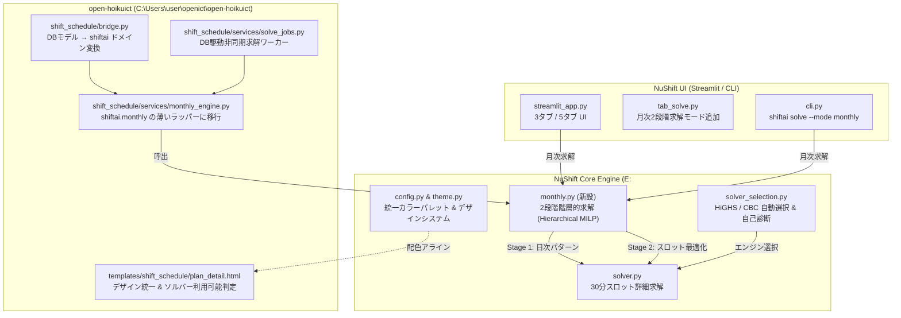

# Phase 2 詳細実装計画書
## 月次階層最適化の本家統合・ソルバーポータビリティ ＆ デザイン・機能面の完全統一

- **作成日**: 2026-11-13
- **対象プロジェクト**:
  - `NuShift` (`E:\nushift\nushift`)
  - `open-hoikuict` (`C:\Users\user\openict\open-hoikuict`)
- **関連ドキュメント**:
  - `open-hoikuict/docs/phase1-vendor-sync-and-audit-implementation-plan.md`（Phase 1 完了記録）
  - `open-hoikuict/shift_schedule/services/monthly_engine.py`
  - `nushift/docs/FAQ.md`
  - `nushift/src/shiftai/ui/theme.py`
  - `nushift/src/shiftai/config.py`
- **目的**:
  1. `open-hoikuict` 側に独自実装されていた月次2段階階層的最適化エンジン（`monthly_engine.py`）を、フレームワーク非依存の純粋ドメイン関数として NuShift 本家（`shiftai.monthly`）へ統合し、NuShift 単体（CLI / Streamlit UI）でも月次求解を可能にする。
  2. HiGHS（`highspy`）および CBC ソルバーの自動選択・診断機能を洗練し、Windows / Docker 環境でのポータビリティを担保するとともに、open-hoikuict 側のソルバー可用性判定（`solver_available`）を統一する。
  3. open-hoikuict（Tailwind / Emerald基調）と NuShift（Streamlit UI）における**デザインシステム（配色・アイコン・フォント）**、**用語体系（Glossary）**、**機能仕様（シフト記号・労働法規閾値・帳票フォーマット）**、および **FAQ.md / ドキュメント** を完全に統一する。

---

## 1. デザインシステム ＆ 機能統一の基本方針

### 1.1 カラーパレット統一基準

両アプリのステータスカラーを、WCAG 2.1 AA 準拠のコントラスト比を満たす Tailwind Emerald / Slate パレットへアラインします。

| 状態区分 | open-hoikuict (Tailwind) | NuShift 現行 | NuShift Phase 2 統一値 | 用途・意味 |
|---|---|---|---|---|
| **プライマリ** | `emerald-600` (`#059669`) | `#2E7D32` | **`#059669`** (Emerald) | メインボタン、アクティブタブ、強調 |
| **勤務 (Work)** | `emerald-50` / `emerald-700` | `#2E7D32` | **`#059669`** (Ink: `#064E3B`) | 出勤セル、適法充足時間帯 |
| **休憩 (Break)** | `amber-50` / `amber-700` | `#F9A825` | **`#D97706`** (Ink: `#78350F`) | 休憩時間帯（法定60分確保） |
| **公休 (Off)** | `slate-100` / `slate-500` | `#EEEEEE` | **`#F1F5F9`** (Ink: `#475569`) | 所定休日、希望休、有給休暇 |
| **不足 (Shortfall)** | `rose-50` / `rose-700` | `#E53935` | **`#E11D48`** (Ink: `#881337`) | 法令配置割れ、要件未達（BLOCKER） |
| **過剰 (Over)** | `indigo-50` / `indigo-700` | `#1E88E5` | **`#4F46E5`** (Ink: `#312E81`) | 必要数を超える余裕配置時間帯 |
| **固定 (Pinned)** | `purple-100` / `purple-700` | `#6a1b9a` | **`#7C3AED`** (Ink: `#4C1D95`) | 現場手動編集・ピン留め保護セル |

### 1.2 用語（Terminology）統一辞書

| 概念 | 統一用語 | 禁止・非推奨用語 | 英語内部識別子 | 理由・備考 |
|---|---|---|---|---|
| 対象児童 | **園児** | 児童、乳幼児、子供 | `Child` / `child` | 保育所・こども園の現場実務用語に統一 |
| 勤務従事者 | **職員** | スタッフ、従業員、保育者 | `StaffMember` / `staff` | 保育士、看護師、支援員等を包括する正式呼称 |
| 免許保有者 | **保育士** | 有資格者（文脈による） | `Role.HOIKUSHI` | 国家資格としての保育士 |
| 休暇・不在 | **希望休** / **出勤不可** | 不在、休み希望 | `unavailability` | 職員申請時は「希望休」、ソルバー内は「出勤不可」 |
| 時間帯区分 | **勤務スロット** / **勤務パターン** | シフト枠、コマ | `slot` / `pattern` | 30分単位はスロット、早番日勤等はパターン |
| 人員要件 | **法令配置基準** | 必要人数、必要人員 | `staffing_standard` | 厚労省告示第49号に基づく基準であることを明示 |

### 1.3 アイコン・絵文字体系の統一

- 🧸 **nusoft / open-hoikuict**: 総合保育ICTプラットフォーム（園児台帳、登降園、保護者ポータル）
- ⚡ **NuShift**: 数理最適化シフト自動作成エンジン（MILP求解、再生成）
- 🛡️ **コンプライアンス**: 労基法第32・34条チェック、BLOCKER 承認ゲート
- 🚨 **アラート**: 配置割れ（ギャップ）、突発欠勤

---

## 2. アーキテクチャ概要図（Phase 2）

---

## 3. 詳細実装ステップ（全7ステップ・サブステップ分解）

### Step 1: 【設計・ベースライン】NuShift 側テスト修復 ＆ 現状ベースライン固定

> **背景**: 先の調査で判明した通り、NuShift 本家の最新コミット `e3f673e` 後のテストスイートで、旧内部モジュール直接参照によるテスト落ちが存在します。移植前に本家のテストを正常化し、ベースラインを強固にします。

| # | サブステップ | 対象ファイル | 作業内容 | 検証コマンド / 期待結果 |
|---|---|---|---|---|
| **1.1** | 失敗テストの特定 | `E:\nushift\nushift\tests` | NuShift 側の pytest を実行し、失敗しているテストファイル名とエラー原因（旧 `solver_core.constraints.*` インポート等）をリストアップ。 | `pytest E:\nushift\nushift\tests -q --tb=short` → 失敗箇所の一覧取得 |
| **1.2** | 旧インポートの修正 | `E:\nushift\nushift\tests\` 該当ファイル | コミット `e3f673e` で統合された `solver_core.repair` や `solver.py`、`statutory_rules.py` の新パスへの修正。 | `pytest E:\nushift\nushift\tests -q` → **全テスト緑化（PASS）確認** |
| **1.3** | デザイン定義テスト作成 | `E:\nushift\nushift\tests\test_theme_harmonization.py`（新規） | `config.py` の配色定数が Emerald 基調（`#059669`）になっているかを検証するテストを作成（現状は `#2E7D32` なので **FAIL (Red)** を確認）。 | `pytest E:\nushift\nushift\tests\test_theme_harmonization.py -q` → **AssertionError (Red確認)** |

---

### Step 2: 【数理最適化】NuShift コアへの月次2段階最適化エンジン（`monthly.py`）実装

| # | サブステップ | 対象ファイル | 作業内容 | 検証コマンド / 期待結果 |
|---|---|---|---|---|
| **2.1** | 失敗テスト作成 | `E:\nushift\nushift\tests\test_monthly_hierarchical.py`（新規） | 職員8名、30日間のサンプルデータで `solve_monthly_hierarchical(...)` を呼び出し、(a) 所定公休数の確保、(b) 最大連続勤務日数（6日以下）の遵守、(c) 30分スロット解の取得、を検証するテストを作成。未実装のため **FAIL (Red)**。 | `pytest E:\nushift\nushift\tests\test_monthly_hierarchical.py -q` → **ImportError / Red確認** |
| **2.2** | 純粋ドメインデータ構造の定義 | `E:\nushift\nushift\src\shiftai\domain.py` | `MonthlySolveContext` を定義（`StaffContracts` への DB 依存を排除し、`shiftai.domain.Contract` を保持）。 | `python -m ruff check src/shiftai/domain.py` |
| **2.3** | `monthly.py` の移植・実装 | `E:\nushift\nushift\src\shiftai\monthly.py`（新規） | open-hoikuict の `monthly_engine.py` から SQLModel / Session 依存を完全に除外した純粋関数として定式化: - `Stage 1`: 月間日次パターン割当 MILP（公休目標・連続勤務・前月末履歴・年休平準化） - `Stage 2`: 30分スロット詳細割当（Stage 1 を Warm-Start / 固定条件として拘束し `solve_shift` 呼出） | `python -m ruff check src/shiftai/monthly.py` |
| **2.4** | テスト実行（Green化） | `E:\nushift\nushift\tests\test_monthly_hierarchical.py` | Step 2.1 のテストを実行し、月次求解が正常終了（FEASIBLE / OPTIMAL）することを確認。 | `pytest E:\nushift\nushift\tests\test_monthly_hierarchical.py -q` → **全パス確認（Green）** |

---

### Step 3: 【UI・CLI】NuShift Streamlit UI ＆ CLI の月次モード対応

| # | サブステップ | 対象ファイル | 作業内容 | 検証コマンド / 期待結果 |
|---|---|---|---|---|
| **3.1** | CLI 引数拡張 | `E:\nushift\nushift\src\shiftai\cli.py` | `shiftai solve` に `--mode {weekly,monthly}` 引数を追加（既定: `weekly`）。`--mode monthly` 指定時に `solve_monthly_hierarchical` を実行。 | `pytest E:\nushift\nushift\tests\test_cli.py -q` |
| **3.2** | Streamlit UI 求解タブ拡張 | `E:\nushift\nushift\src\shiftai\ui\tab_solve.py` | 求解期間の選択（「週単位 (7日間)」または「月次一括 (当月1日〜末日)」ラジオボタン）を追加。月次選択時は 2 段階進捗インジケータ（Stage 1: 日次パターン決定 → Stage 2: 30分スロット最適化）を表示。 | 手動実行または UI スモークテスト |
| **3.3** | UI スモークテスト | `E:\nushift\nushift\tests\test_ui_monthly_smoke.py`（新規） | 月次モード選択時の状態遷移および求解パラメータ生成を検証。 | `pytest E:\nushift\nushift\tests\test_ui_monthly_smoke.py -q` → **全パス確認** |

---

### Step 4: 【ポータビリティ】HiGHS / CBC 自動検出・自己診断エンジンの強化

| # | サブステップ | 対象ファイル | 作業内容 | 検証コマンド / 期待結果 |
|---|---|---|---|---|
| **4.1** | ソルバー自動検出テスト作成 | `E:\nushift\nushift\tests\test_solver_portability.py`（新規） | `select_optimal_solver()` が環境内の最速利用可能ソルバー（HiGHS > PULP_CBC_CMD）を正しく自動選択することを検証。 | `pytest E:\nushift\nushift\tests\test_solver_portability.py -q` |
| **4.2** | ソルバー選択ロジック洗練 | `E:\nushift\nushift\src\shiftai\solver.py` | `select_optimal_solver()` を新設。`highspy`（HiGHS）が利用可能なら最優先で選択し、なければ CBC へ安全フォールバック。利用可能なソルバー情報を診断データ（`SolverDiagnostics`）として返却可能にする。 | `python -m ruff check src/shiftai/solver.py` |
| **4.3** | 自己診断 CLI 強化 | `E:\nushift\nushift\src\shiftai\diagnostics.py` | `shiftai doctor`（または `shiftai diagnostics`）コマンドで、Python バージョン、PuLP、HiGHS、CBC の検出状態と導入手順を端末にわかりやすく色付き表示。 | `python -m shiftai.diagnostics` 実行確認 |

---

### Step 5: 【ホスト連携】open-hoikuict 側への同期 ＆ ソルバー判定の統一

| # | サブステップ | 対象ファイル | 作業内容 | 検証コマンド / 期待結果 |
|---|---|---|---|---|
| **5.1** | 最新 NuShift の vendor 同期 | `open-hoikuict/scripts/sync_nushift_vendor.py` | `python scripts/sync_nushift_vendor.py --source E:\nushift\nushift` を実行。Step 2〜4 で NuShift に追加された `monthly.py` やソルバー選択ロジックを vendor へ反映。 | `python scripts/check_vendor_integrity.py` → **SUCCESS** |
| **5.2** | `monthly_engine.py` のラッパー化 | `open-hoikuict/shift_schedule/services/monthly_engine.py` | 自前の MILP 定式化コード（約150行）を削除し、`from shiftai.monthly import solve_monthly_hierarchical` を呼び出す薄いアダプター（DB モデル `StaffContracts` → `Contract` 変換）にリファクタリング。 | `python -m ruff check shift_schedule/services/monthly_engine.py` |
| **5.3** | ソルバー可用性判定の統一 | `open-hoikuict/shift_schedule/routers/plans.py` + `plan_detail.html` | ルーターのコンテキスト `cbc_available` を **`solver_available`**（HiGHS または CBC のいずれか）に改名・拡張。画面上の「CBC 未検出」ボタンを「ソルバー未検出（HiGHS / CBC）」に統一。 | `python -m pytest tests/routers/test_shift_schedule_features.py -q` |
| **5.4** | open-hoikuict 側回帰テスト | `open-hoikuict/tests/` | `tests/test_monthly_engine.py` およびシフト統合 E2E テストを実行し、自前実装から vendor 呼び出しへの移行によるデグレが一切ないことを検証。 | `python -m pytest tests/test_monthly_engine.py tests/test_shift_integration_e2e.py -q` → **全パス確認** |

---

### Step 6: 【デザイン統一】NuShift テーマ・カラーパレット・帳票スタイルのアラインメント

| # | サブステップ | 対象ファイル | 作業内容 | 検証コマンド / 期待結果 |
|---|---|---|---|---|
| **6.1** | NuShift テーマカラー更新 | `E:\nushift\nushift\src\shiftai\config.py` ＆ `.streamlit/config.toml` | `COLOR_WORK` および `primaryColor` を open-hoikuict の Emerald `#059669` に更新。`COLOR_BREAK`（`#D97706`）、`COLOR_SHORTFALL`（`#E11D48`）、`COLOR_OVER`（`#4F46E5`）にアライン。 | `pytest E:\nushift\nushift\tests\test_theme_harmonization.py -q` → **PASS（Green化）** |
| **6.2** | CSS ＆ ウィジェットスタイル調整 | `E:\nushift\nushift\src\shiftai\ui\theme.py` | スタイルシート（CSS変数 `--shiftai-work` 等）の文字色（Ink）をコントラスト比の高い色に調整。角丸（`border-radius: 12px` = Tailwind `rounded-xl`）に統一。 | ブラウザ目視または CSS 定数値テスト |
| **6.3** | Excel / CSV 帳票スタイルの統一 | `E:\nushift\nushift\src\shiftai\exporter.py` ＆ `open-hoikuict/shift_schedule/services/nushift_export.py` | Excel 勤務割表のヘッダー色（Emerald `#059669`）、フォント（Meiryo UI）、表題、免責条項文言（「労働基準法第32条遵守・自治体指導監査用参考資料」）を両プロジェクトで完全一致させる。 | `pytest E:\nushift\nushift\tests\test_exporter.py -q` |

---

### Step 7: 【ドキュメント・回帰】FAQ.md 全面改訂 ＆ 包括的 E2E 回帰テスト

| # | サブステップ | 対象ファイル | 作業内容 | 検証コマンド / 期待結果 |
|---|---|---|---|---|
| **7.1** | `FAQ.md` の全面最新化 | `E:\nushift\nushift\docs\FAQ.md` | (1) 表題を `nusoft v0.3.5` から最新版へ更新。 (2) 「Q. なぜ計算単位は週なのか？」の回答を改訂し、「2段階階層的最適化（Hierarchical MILP）による月次一括作成（30〜31日）に対応」した旨と仕組みを明記。 (3) ソルバー（HiGHS / CBC）のポータビリティに関する Q&A を追加。 | ドキュメント差分確認 |
| **7.2** | 操作マニュアル・Q&A 統一 | `E:\nushift\nushift\MANUAL.md`, `open-hoikuict/MANUAL.md` | 月次モードの操作手順（所定公休目標、前月末連続勤務引継ぎ）を追記。 | ドキュメント差分確認 |
| **7.3** | 最終総合回帰テスト（両リポジトリ） | 両リポジトリ全テストスイート | (1) NuShift 側: `pytest tests -q` (2) open-hoikuict 側: `pytest tests/test_shift_* tests/services/test_shiftai_* -q` (3) ベンダー検証: `python scripts/check_vendor_integrity.py` | **両リポジトリで全テスト 100% PASS** |

---

## 4. リグレッション防止テスト計画マトリクス（Phase 2）

| テスト分類 | テストファイル | テスト対象関数 / 画面 | 検証観点（アサーション内容） |
|---|---|---|---|
| **月次2段階MILP** | `nushift/tests/test_monthly_hierarchical.py` | `solve_monthly_hierarchical` | ・Stage 1: 月間所定公休数（例: 8日）の厳密確保 ・Stage 1: 最大連続勤務日数（6日以下）の厳守 ・Stage 1: 前月末連続勤務日数（例: 3日）の境界制約引き継ぎ ・Stage 2: 30分スロット詳細配置が Stage 1 パターンと整合 |
| **テーマ・デザイン** | `nushift/tests/test_theme_harmonization.py` | `shiftai.config` `shiftai.ui.theme` | ・`primaryColor` および `COLOR_WORK` が `#059669` であること ・各 Ink 文字色とのコントラスト比が 4.5:1 以上であること |
| **ソルバー選択** | `nushift/tests/test_solver_portability.py` | `select_optimal_solver` `available_solvers` | ・HiGHS 利用可能環境で HiGHS が選択されること ・CBC のみ環境で CBC にフォールバックすること ・両者未検出時に明確な例外（`SolverNotFoundError`）が送出されること |
| **ホスト連携ラッパー** | `open-hoikuict/tests/test_monthly_engine.py` | `solve_monthly_hierarchical` (host) | ・DB モデル `StaffContracts` から `Contract` への変換完全性 ・求解結果 `SolveResult` が既存のプランセル生成サービスに適合すること |
| **画面ソルバー判定** | `open-hoikuict/tests/routers/test_shift_schedule_features.py` | `GET /shifts/plans/{id}` | ・HiGHS のみ存在する場合でも「シフトを再生成」ボタンが活性化すること ・ソルバー皆無時に「ソルバー未検出」と表示されること |
| **エクスポート帳票** | `nushift/tests/test_exporter.py` `open-hoikuict/tests/routers/test_nushift_export_audit.py` | Excel 勤務割表出力 NuShift CSV 出力 | ・Excel のヘッダーカラーが Emerald `#059669` であること ・免責文言が両アプリの出力帳票で完全に一致すること |

---

## 5. ロールバック計画（Rollback Plan）

1. **NuShift コアのロールバック**:
   - `git checkout -- src/shiftai/config.py src/shiftai/ui/theme.py .streamlit/config.toml`
   - `git rm src/shiftai/monthly.py`
2. **open-hoikuict 側ラッパーのロールバック**:
   - `git checkout -- shift_schedule/services/monthly_engine.py shift_schedule/routers/plans.py templates/shift_schedule/plan_detail.html`
3. **ベンダー整合性の復元**:
   - `python scripts/sync_nushift_vendor.py --source E:\nushift\nushift`
   - `python scripts/check_vendor_integrity.py` で即座に確認。

---

## 6. 作業完了チェックリスト（Phase 2）

- [ ] **Step 1**: NuShift 本家テスト落ちの修正（全テスト緑化） ＆ デザイン統一失敗テスト（Red）作成
- [ ] **Step 2**: NuShift コアに純粋関数 `solve_monthly_hierarchical`（`monthly.py`）実装 ＆ 単体テスト PASS
- [ ] **Step 3**: NuShift Streamlit UI（`tab_solve.py`）および CLI に月次モード追加 ＆ スモークテスト PASS
- [ ] **Step 4**: ソルバー自動選択（`select_optimal_solver`） ＆ 自己診断（`diagnostics.py`）強化
- [ ] **Step 5**: open-hoikuict の `monthly_engine.py` を vendor 呼び出しに移行 ＆ 画面ソルバー判定を `solver_available` に統一
- [ ] **Step 6**: カラーパレット（Emerald `#059669`）、角丸（`rounded-xl`）、Excel 帳票スタイルの完全統一
- [ ] **Step 7**: `FAQ.md` 全面改訂（月次対応・最新版表記） ＆ 両リポジトリでの全件総合回帰テスト PASS

