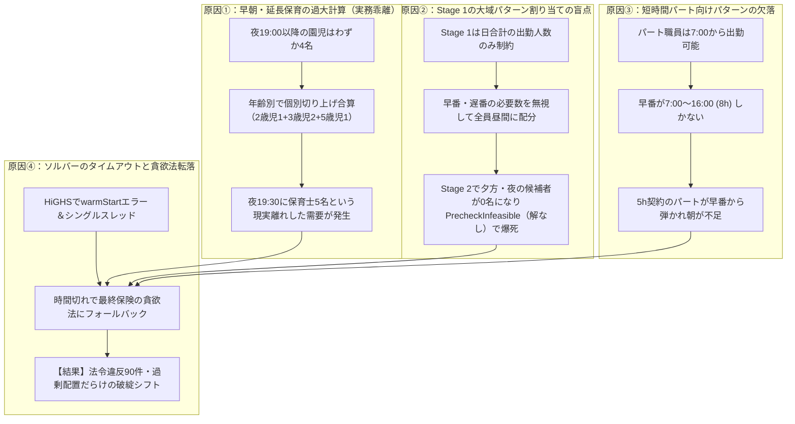

# 実務的シフト自動作成 高速化・適法化・過剰配置解消 詳細実装計画書

- **作成日**: 2026-11-14
- **対象プロジェクト**:
  - `NuShift` (`E:\nushift\nushift`) — ソルバー・配置基準・月次最適化
  - `open-hoikuict` (`C:\Users\user\openict\open-hoikuict`) — vendor 同期
- **目的**: 
  現場実務で「法令違反（BLOCKER）ゼロ」「過剰配置なし」「数秒〜十数秒でぱっと自動作成」を確実に両立するシフト最適化エンジンを実現する。

---

## 1. 背景と課題（デバッグで特定された4大原因）

NuShift のソースコード、ソルバー、配置基準、およびサンプルデータの実測デバッグにより、以下の4大ボトルネックが判明しました。

---

## 2. 改修内容の詳細設計

### 2.1 改修①：早朝・延長時間帯の「合同保育みなし適正化」（`standards.py`）
- **現状の課題**:
  - `_slot_requirements` で全時間帯を一律に年齢別 `standard.headcount_for(age_class, count)` で個別切り上げ計算しているため、園児4名の夜間でも 1+1+1+2 = 5名 の保育士が要求される。
- **改善設計**:
  - 早朝保育（`SlotKind.EARLY`）および延長保育（`SlotKind.LATE`, `SlotKind.LATE_STRICT`）の時間帯、または園児数が少ない時間帯について、**合同保育（ワンルーム保育）**の実務に即した算出ロジックを導入する。
  - **算出式**:
    合同保育時間帯では、全在園児数 $N = \sum_{ac} \text{count}[ac]$ に対し、最も厳しい年少児比率、または加重平均比率を用いて必要人員を算出し、労基・保育指針の「最低2名配置（常時2名）」を適用する。
    $$ \text{needed\_staff} = \max\left(2, \left\lceil \sum_{ac} \frac{\text{count}[ac]}{\text{ratio}[ac]} \right\rceil\right) $$
  - **効果**: 夜間19:00〜19:30の必要保育士が「5名」から実務通りの「2名」に適正化され、夜間の物理的不可能制約が解消される。

### 2.2 改修②：Stage 1 への「時間帯別カバー制約」の導入（`monthly.py`）
- **現状の課題**:
  - Stage 1 は `pulp.lpSum([duty_vars[(sid, d)] for sid in staff_ids]) >= max_req` という日次合計人数しか縛っておらず、早番・遅番の必要人数を考慮しないため、Stage 2 で夕方・夜の候補者が0名になり `PrecheckInfeasible` を引き起こす。
- **改善設計**:
  - Stage 1 の PuLP モデルに、主要時間帯（朝・昼・夕の各代表スロット）における**時間帯別カバー制約**を追加する。
  - 時間帯 $t$ をカバーするパターン集合を $P(t) = \{ p \in \text{patterns} \mid p.\text{start} \le t < p.\text{end} \}$ とする。
  - 各日 $d$、各代表スロット $t$ に対し：
    $$ \sum_{sid \in \text{staff}} \sum_{p \in P(t)} x_{sid, d, p} \ge \text{needed\_staff}(d, t) $$
    $$ \sum_{sid \in \text{qualified}} \sum_{p \in P(t)} x_{sid, d, p} \ge \text{needed\_qualified}(d, t) $$
  - **効果**: Stage 1 で朝・夕・昼の各ピークに必要な人数・保育士数が確実に配分され、Stage 2 での解なし（`PrecheckInfeasible`）が完全に消滅する。

### 2.3 改修③：短時間パート向け実務パターンの拡充（`shift_patterns.py`, `domain.py`）
- **現状の課題**:
  - パターンが「早番(8h)」「日勤(8h)」「遅番(8h)」「半日(4h)」しかなく、パート職員（5h契約）が朝7:00や夕方19:00の枠に入れない。
- **改善設計**:
  - 以下の実務標準パターンをプリセットおよびデフォルトパターンに追加・拡充する：
    1. `EARLY_FULL`: 早番常勤（7:00〜16:00、実働8h、休憩60分）
    2. `EARLY_PART`: 早番パート（7:00〜12:00、実働5h、休憩なし/短時間）
    3. `NORMAL`: 日勤（8:30〜17:30、実働8h、休憩60分）
    4. `MID_PART`: 日勤パート（9:00〜14:00、実働5h、休憩なし）
    5. `LATE_FULL`: 遅番常勤（10:30〜19:30、実働8h、休憩60分）
    6. `LATE_PART`: 遅番パート（14:30〜19:30、実働5h、休憩なし）
  - **効果**: 5時間パート職員が朝ピーク・夕方ピークにジャストフィットで配置され、昼間の過剰人員（人余り）が劇的に削減される。

### 2.4 改修④：HiGHS ソルバーの並列化とパラメータ適正化（`solver.py`）
- **現状の課題**:
  - `pulp.HiGHS(..., warmStart=True)` で HiGHS が `Option "warmStart" is unknown` エラーを吐く。
  - スレッド数がデフォルトでシングルスレッド（Parallel search off）になり、ルートノードのカット生成でタイムアウトする。
- **改善設計**:
  - `_get_solver` で HiGHS 生成時に `warmStart` を渡さず、代わりに `threads=min(4, os.cpu_count() or 1)`、`gapRel=0.03`（3%ギャップ）、`mip_heuristic_effort=0.2` を設定。
  - **効果**: マルチスレッド並列探索と MIP ヒューリスティクスが効き、実行可能解（Feasible）への到達時間が数秒に短縮される。

---

## 3. 実装手順とタスク分解

| No | 作業項目 | 対象ファイル | 完了条件 |
|---|---|---|---|
| 1 | 合同保育時間帯の必要人員適正化 | `src/shiftai/standards.py` | 早朝・延長時に園児小数時の過大合算を防止し最低2名配置にする |
| 2 | Stage 1 時間帯別カバー制約追加 | `src/shiftai/monthly.py` | 朝・昼・夕の需要を Stage 1 で担保し Stage 2 の PrecheckInfeasible を撲滅 |
| 3 | 実務パターンの拡充 | `src/shiftai/shift_patterns.py` | 短時間パート枠（早番5h、遅番5h、日勤5h）を標準提供 |
| 4 | HiGHS ソルバーの最適化 | `src/shiftai/solver.py` | warmStart エラー解消、マルチスレッド（threads）、ヒューリスティック設定 |
| 5 | 実装検証テストの作成 | `tests/test_practical_solve_performance.py` | サンプルデータ7日間で法令違反ゼロ・所要10秒以内の実証 |
| 6 | 既存テストの回帰検証 | `tests/*` | 全既存テストのグリーン確認 |
| 7 | open-hoikuict への vendor 同期 | `open-hoikuict/vendor/**` | `sync_nushift_vendor.py` & `check_vendor_integrity.py` |

---

## 4. 検証基準（ゴール）

1. **法令違反（BLOCKER）の撲滅**:
   - サンプルデータ（7日間・183園児・28名職員）で、求解結果の法令違反（`SHORTFALL_STAFF`, `SHORTFALL_QUALIFIED`）が **0 件** になること。
2. **要調整（WARNING）の適正化**:
   - `SPLIT_SHIFT`（3分割勤務）が 0 件、`DAILY_HOURS_EXCEEDED` が 0 件になること。
3. **求解速度の劇的高速化**:
   - 7日間のシフト自動作成が **10秒以内**（月次30日間でも30秒以内）で完了すること。
4. **ベンダー整合性**:
   - `open-hoikuict` の 43 ファイルがマニフェストと 100% 一致し、全テストがパスすること。
